

  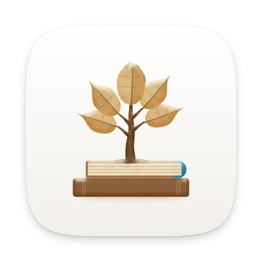

<h1 align="center">Daf</h1>

<b>My own Readwise, for an hour of reading a day.</b> It counts every minute I read, wherever I read it, and brings my highlights back every morning.

  
  
  
  
  
  
  

  <a href="docs/README.md"><b>Docs</b></a> ·
  <a href="#install">Install</a> ·
  <a href="#features">Features</a> ·
  <a href="#screenshots">Screenshots</a> ·
  <a href="docs/how-i-use-it.md">A day with Daf</a>

<picture>
  <source media="(prefers-color-scheme: dark)" srcset="docs/images/hero-dark.png">
  
</picture>

## Why I built it

I gave myself one goal for a year: read for an hour a day. I call it Year 30. The year before, I read on plenty of days, but only a handful of them reached the hour, which told me the problem wasn't wanting to read, it was that nothing kept the hour in front of me.

I used Readwise Reader for years and I liked it, but it only knows what I read inside it. Most of my reading happens on a Kindle with KOReader, in audiobooks, and in paper books, and none of that showed up anywhere. So I started building my own. "Daf" is Hebrew for a page, as in daf yomi, the page a day.

Daf gathers the minutes from everywhere I read, the Kindle, Audiobookshelf, the paper books I log with a text message, and the books and articles I read in Daf itself, and puts them in one ring. Then it does what I loved about Readwise: it brings my highlights back every morning, so what I read stays with me. Basically, instead of five apps that each know a piece of my reading, I have ONE page that tells me how far I am from the hour.

## Features

### Counting the hour

- **Today.** A ring with today's minutes, where they came from, each sitting with its book and page, the week, and Year 30 as a grid of 365 days, with Year 29 under it.
- **Every place I read.** The Kindle (through a KOReader plugin), audiobooks from Audiobookshelf, paper books, and books, articles and manga read in Daf all count. Podcasts show up but never count, and videos are off unless I switch them on.
- **Paper books.** I press **Log paper**, or I text my Signal bot "read 40 paper" or "shabbat 60" after havdalah, and the minutes land on the right day and in my vault's reading log.
- **Goals.** Reading time a day, week or month, plus pages, books, days with reading, a streak, highlights and the daily review, each one on or off, with presets called Gentle, Year 30 and Deep.
- **Stats.** Streaks, totals, when in the day I read, where the minutes came from, books that are waiting for me, and "On this day".
- **Private books.** Some books I keep private: they count toward the hour, but their titles never show up in the review, the morning message, the widget or the Kindle.

### Reading in Daf

- **Books.** Every book in my Calibre library (EPUB, MOBI, AZW3, FB2 or CBZ) opens in Daf's own reader, built on foliate-js, in Scroll or Pages, with footnotes in a popover and minutes left in the chapter. If the Kindle is further along, Daf offers to go there.
- **Themes and typefaces.** 17 themes, each in a light and a dark version, 24 reading faces that Daf serves itself, Hebrew ones too, and any font I add, like Bookerly. The choice follows me to every device.
- **The Feed and the Library.** The Feed is my FreshRSS, and it replaced Read You for me. The Library is Daf's own now (it was Karakeep until October): articles, tweets, PDFs and YouTube videos with their transcripts, plus the newsletters I pick. Daf reads every page I save from my server, keeps its text and picture, and gives it a short summary and a few tags.
- **Bringing a library over.** The export file from Instapaper, Pocket, Omnivore, Readwise Reader, Raindrop, GoodLinks or Wallabag comes in with its tags, stars and read status, and its highlights where the app exports them. Browser bookmarks and OPML feeds work too.
- **The morning email.** At the hour I pick, what I saved the day before, each with its summary, plus what's waiting in the Feed.
- **PDFs.** Read as text, or as printed with pdf.js, with highlights on the page.
- **Listen.** Any article or book read aloud by Kokoro, in the voice I pick, following along sentence by sentence, and the time counts.
- **The Torah shelf.** The week's parasha and haftarah from Sefaria, Hebrew beside the English, the week's divrei Torah, and the essays in the vault for that parasha.
- **Look it up.** Select a word for a definition (Hebrew from Sefaria's dictionaries, English from Wiktionary), or ask about the passage you're in.
- **Keys and Undo.** Keys for every list, article, book and the review, which I can change in Preferences, and an Undo for everything I do to a list, Delete included.
- **Offline.** The Mac and Android apps keep their own copy of Daf, so they open and work with no connection. **Keep on this device** holds on to any article or book I want with me, and a manga volume downloads with one button. In a browser, what I've opened before keeps working.

### Highlights that come back

- **One place for every highlight.** The Kindle's, Daf's own, Karakeep's, audiobook bookmarks, photos of marked paper pages, and my old Readwise highlights, in five colors, with notes and tags. A picture in an article can be a highlight too.
- **Open at the exact spot.** Every highlight opens where it is in the book or article, and the spot flashes.
- **The daily review.** Five highlights a day, spaced so the ones I keep come back less and less often. The first one comes to my phone every morning, and a reply becomes a note.
- **Flashcards.** Fill in the blank or question and answer, graded like Anki, and exported for Anki too.
- **Into the vault.** Highlights and notes go into my Obsidian notes, which means the vault is the record and Daf is the reading room.

### Everywhere I read

- **The Kindle.** The plugin sends reading time, shows today's minutes on the sleep screen, and gives KOReader a Home page, Shelves for moving books between folders, and a Daf tab with the review and the nightstand. Places and highlights go both ways.
- **Mac.** A native window, Daf's menus, today's minutes in the menu bar, "Save to Daf" in the share menu, the Safari extension, and its own copy of Daf for a plane or a server that's down.
- **Android.** A home-screen widget with the ring, "Save to Daf" in the share sheet, the volume keys turning pages if I want them to, listening with the screen off, and its own copy of Daf, with the books and articles I keep, for no signal.
- **The browser extension.** Highlight on any web page in Firefox, Zen, Chrome, Arc or Safari, and the page goes into the Library with the highlight on it. The right-click menu saves a page or a link without highlighting (Alt+Shift+S saves the page), and a paywalled article I'm signed in to comes in whole.
- **Send to Kindle.** Articles go to the Kindle as one EPUB, or a digest of several, and what I highlight there comes back to the article.

## Screenshots

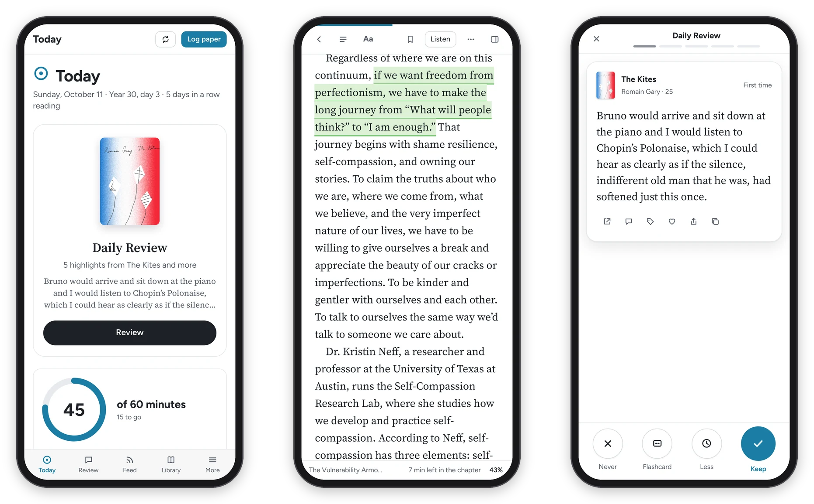

*A book in Daf, with the Kindle's highlights in their colors and the Notebook beside it.*

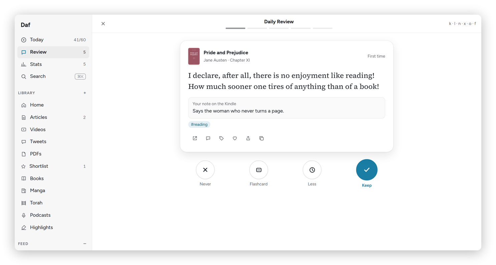
*The daily review: five highlights a day, one at a time.*

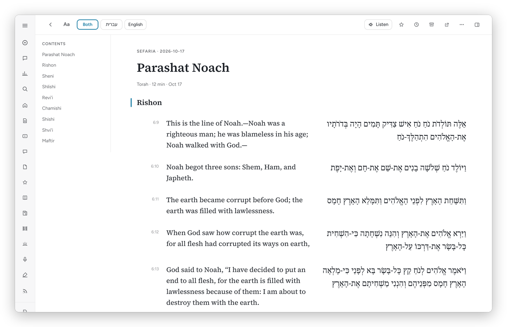
*The week's parasha on the Torah shelf, Hebrew beside the English.*

*Every highlight, from every source, searchable and exportable.*

More screenshots

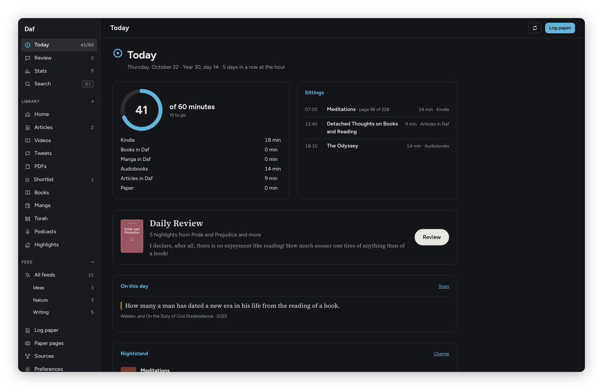
*Today, in dark mode.*

*An article from the Library, a sentence just highlighted.*

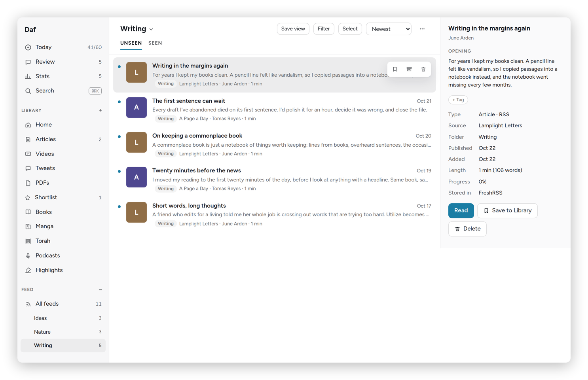
*The Feed, one folder at a time, with the opening of each post.*

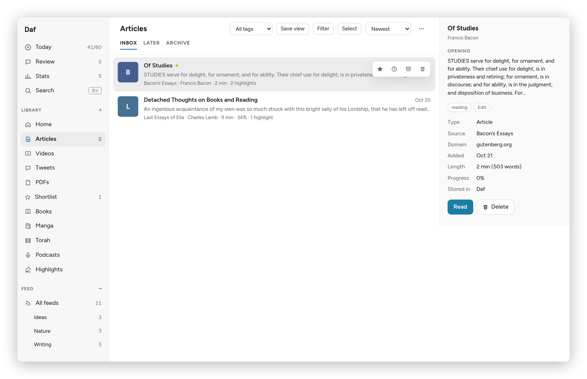
*The Library: Inbox, Later and Archive.*

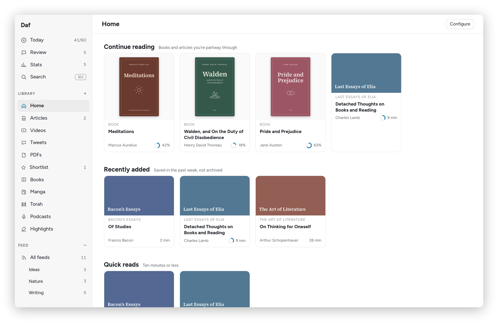
*The Library's Home.*

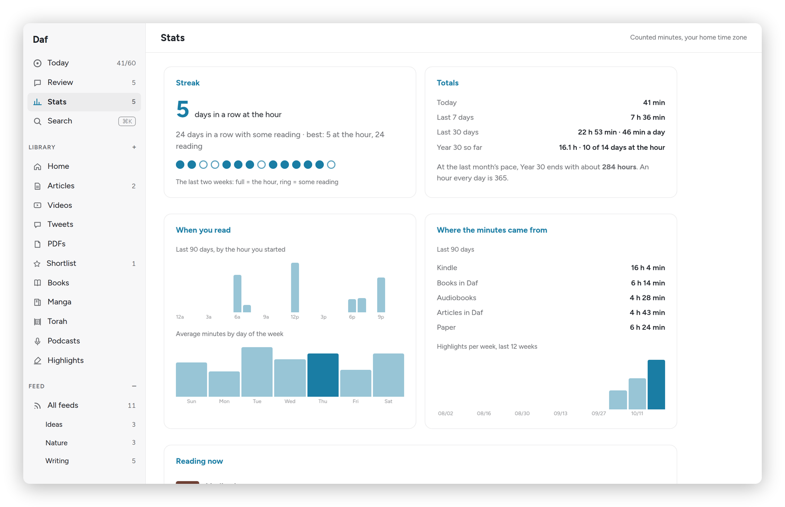
*Stats.*

*A book's page: the time spent with it, its shelves and Hardcover, with its highlights further down.*

*Books: the nightstand and the shelves.*

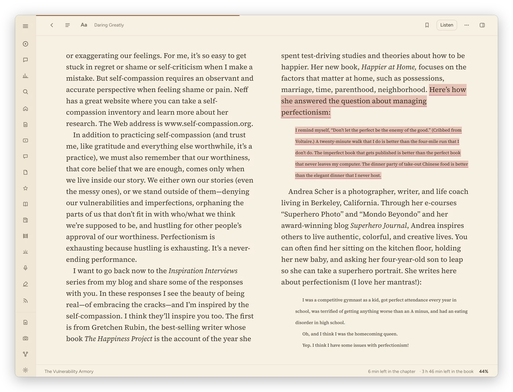
*Pages layout on a tablet, in the Paper theme.*

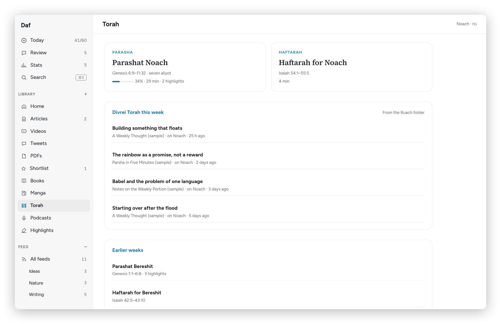
*The Torah shelf.*

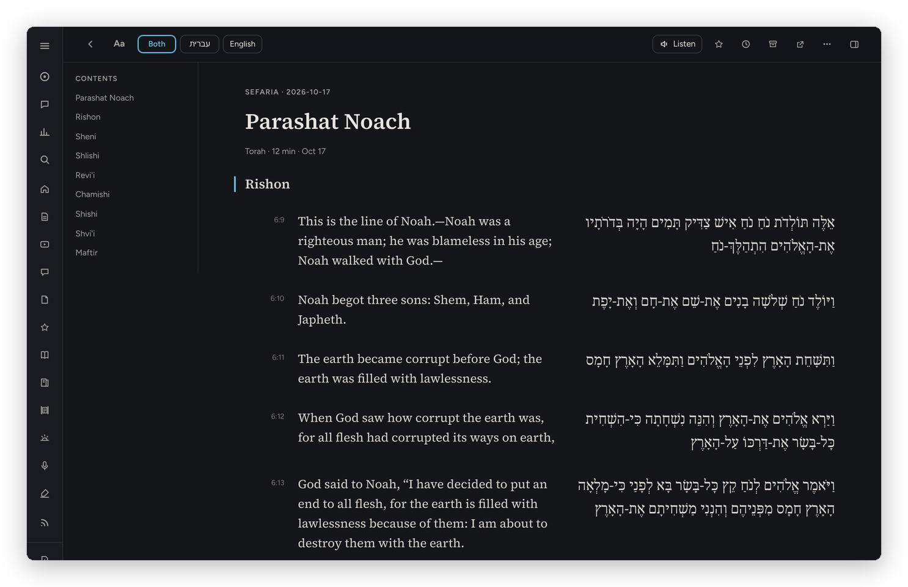
*The parasha in dark mode.*

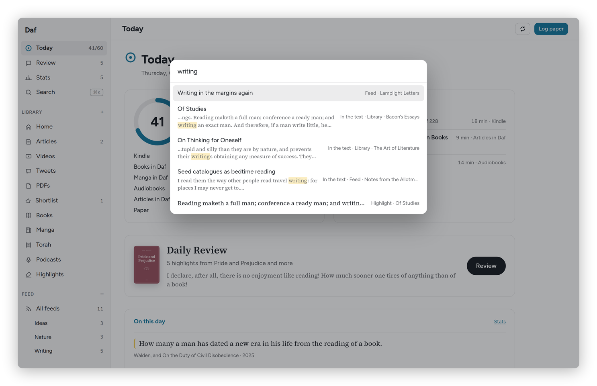
*⌘K searches titles, the full text of what I've saved, highlights and the vault.*

*Goals.*

*Seventeen themes, each in light and dark.*

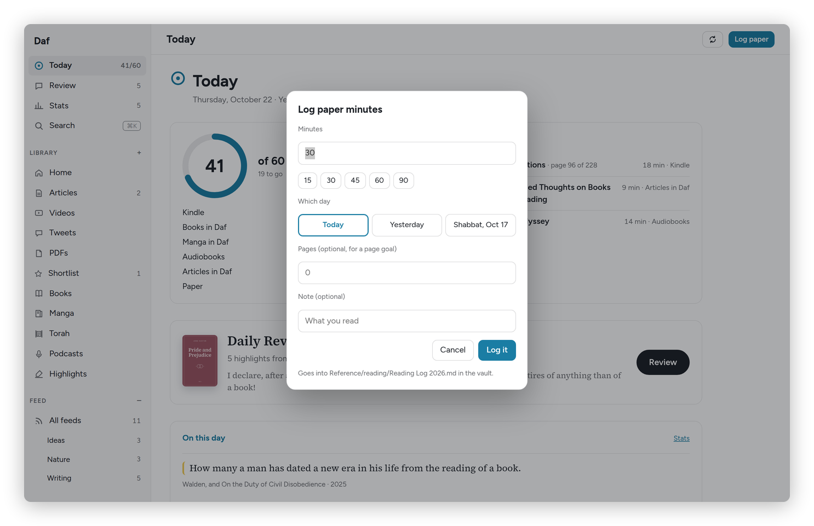
*Logging paper minutes.*

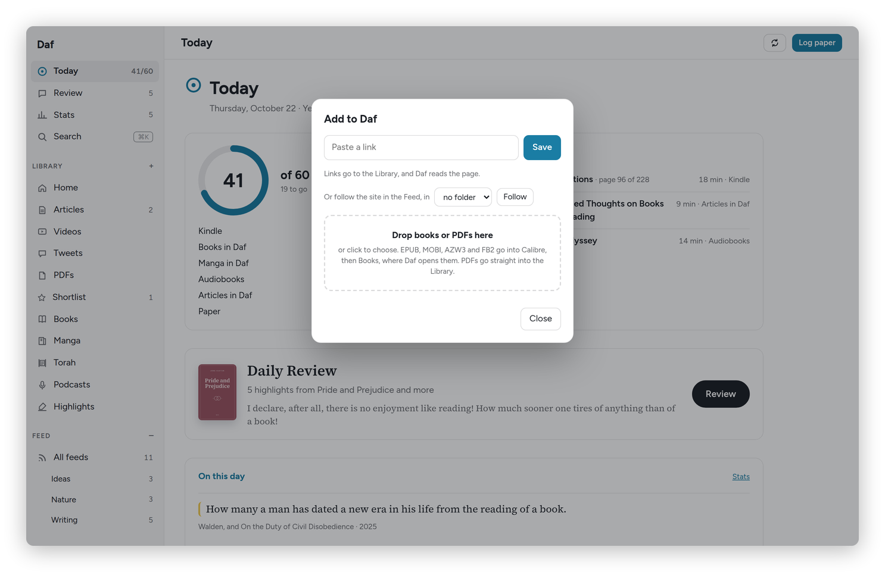
*Adding a link, a book or a PDF.*

## Install

### On the web

Daf is a web app with one sign-in, a username and password, so the copy you open is one somebody runs for you (mine lives on my home server). Open its address in any browser. On a phone, use the browser menu → **Install app**, and Daf opens like an app, with "Save to Daf" in the share menu. Offline reading needs the https address. All the steps are in [Install](docs/install.md).

### Mac

There's no download yet, so the Mac app is built from this repository: on a Mac with the Command Line Tools and `brew install xcodegen`, run `cd mac && ./build.sh` and copy `build/Daf.app` to Applications. See [the Mac app](docs/mac.md) and [mac/README.md](mac/README.md).

### Android

The Android app is built from the repository too: `cd android && ./release.sh` makes a signed APK (it needs JDK 17, the Android SDK and your own keystore), and `adb install -r` puts it on the phone. See [the Android app](docs/android.md) and [android/README.md](android/README.md).

### Kindle (KOReader)

Copy `kindle/daf.koplugin` into KOReader's `plugins` folder and give it a `settings/daf.lua` with your Daf address and a device token from `daf kindle-token kindle`. Then restart KOReader and find it under **Tools → Daf**. See [the Kindle](docs/kindle.md).

### Browser extension

Firefox and Zen take the signed file from **Preferences → Account → Browser extension**, Chrome and Arc load it unpacked, and Safari's comes inside the Mac app. See [the browser extension](docs/browser-extension.md).

### Your own server

Daf is one Python process with a SQLite file, run as a systemd user service. I built it for my server and my services, so a copy of your own means pointing it at yours. [Your own server](docs/server.md) walks through it.

## Documentation

The docs are a set of short pages, written the way I'd explain Daf to a friend.

- **Getting started:** [What is Daf?](docs/what-is-daf.md), [A day with Daf](docs/how-i-use-it.md), [Install](docs/install.md)
- **Using Daf:** [Today and goals](docs/today-and-goals.md), [Where the minutes come from](docs/reading-time.md), [Paper books](docs/paper-books.md), [The reader](docs/reader.md), [The Feed and the Library](docs/feed-and-library.md), [Videos and podcasts](docs/videos-and-podcasts.md), [Highlights and review](docs/highlights-and-review.md), [Books and shelves](docs/books-and-shelves.md), [The Torah shelf](docs/torah.md), [Stats](docs/stats.md), [Manga](docs/manga.md)
- **Devices:** [The Kindle](docs/kindle.md), [The Mac app](docs/mac.md), [The Android app](docs/android.md), [The browser extension](docs/browser-extension.md), [Sharing, messages and the widget](docs/phone-shortcuts.md)
- **Running your own server:** [Your own server](docs/server.md)
- **Under the hood:** [How Daf runs](docs/OPERATIONS.md), [The plan](PLAN.md), [The native apps brief](docs/NATIVE.md), [The shell contract](docs/SHELL.md)

Start with [Getting started](docs/what-is-daf.md).

## How it's built

- **Server:** Python 3.12, FastAPI and SQLite, one process that serves the web app and the API and pulls every source every five minutes. It runs as a systemd user service on my home server.
- **Web app:** plain JavaScript and CSS with no build step, foliate-js for books and pdf.js for PDFs, and a service worker that keeps Daf on the device, so it opens at once and reads offline.
- **Where the data lives:** my Obsidian vault holds every highlight, note and hand-logged minute. Daf's SQLite database is mostly an index of the sources and the vault, plus Daf's own things like the review schedule, places in books and the Library, whose pages and pictures stay on my server. Daf only changes something in those apps when I press the button for it, like marking a post read or unfollowing a feed.
- **What it talks to:** KOReader (through the plugin), Audiobookshelf and Calibre (their databases, read-only), FreshRSS (its API), Karakeep (off since October 2026, when its saves moved into Daf's Library), a headless Chrome for pages that only show themselves to a real browser, Hardcover, Komga, Kokoro for read-aloud, faster-whisper for transcripts, Proton Mail Bridge for newsletters and the morning email, and Claude on my own subscription for Ask, summaries, tags and reading photos of paper pages.
- **The apps:** the Mac app (SwiftUI and AppKit around WKWebView) and the Android app (a WebView) load the live site, keep a copy of it for when there's no connection, and add what a page can't do. The contract between them is [docs/SHELL.md](docs/SHELL.md).

## Credits

- [foliate-js](https://github.com/johnfactotum/foliate-js), the reader inside Foliate, MIT, vendored in `web/vendor/foliate-js` (with fflate, MIT, and zip.js, BSD-3-Clause).
- [pdf.js](https://github.com/mozilla/pdf.js) 4.10.38, Apache 2.0, vendored in `web/vendor/pdfjs`.
- [FastAPI](https://github.com/fastapi/fastapi), MIT, and [Uvicorn](https://github.com/encode/uvicorn), BSD-3-Clause.
- [python-multipart](https://github.com/Kludex/python-multipart), Apache 2.0, [pypdf](https://github.com/py-pdf/pypdf), BSD-3-Clause, [Pillow](https://github.com/python-pillow/Pillow), MIT-CMU, and [Trafilatura](https://github.com/adbar/trafilatura), Apache 2.0.
- [KOReader](https://github.com/koreader/koreader), AGPL-3.0, which the Kindle plugin runs inside.
- [Kokoro](https://huggingface.co/hexgrad/Kokoro-82M), Apache 2.0, for read-aloud, [faster-whisper](https://github.com/SYSTRAN/faster-whisper), MIT, and [yt-dlp](https://github.com/yt-dlp/yt-dlp), Unlicense, for transcripts.
- 24 typefaces from [Fontsource](https://fontsource.org), served by Daf itself from `web/fonts` (`tools/fetch-fonts.py`), all under the SIL Open Font License: Literata, Source Serif 4, Charis SIL, Merriweather, Lora, EB Garamond, Crimson Pro, Newsreader, Spectral, Libre Baskerville, Alegreya, Vollkorn, Bitter, IBM Plex Serif, Atkinson Hyperlegible, Figtree, Inter, Source Sans 3, Lexend, OpenDyslexic, Frank Ruhl Libre, Noto Serif Hebrew, David Libre and Heebo.
- Texts and dictionaries from [Sefaria](https://www.sefaria.org)'s API, each under the license Sefaria lists for it, and English definitions from Wiktionary, CC BY-SA.
- The apps and services Daf reads stay their own: KoInsight, FreshRSS, Karakeep, Audiobookshelf, Calibre-Web-Automated, Komga and Hardcover.

## License

Daf is free software under the [GNU General Public License, version 3](LICENSE). I built it for my own reading on my own server, so in places it assumes my setup: the apps above, a Tailscale network and a systemd user service. [Your own server](docs/server.md) says what to change. The vendored libraries and the fonts keep their own licenses, listed above.
