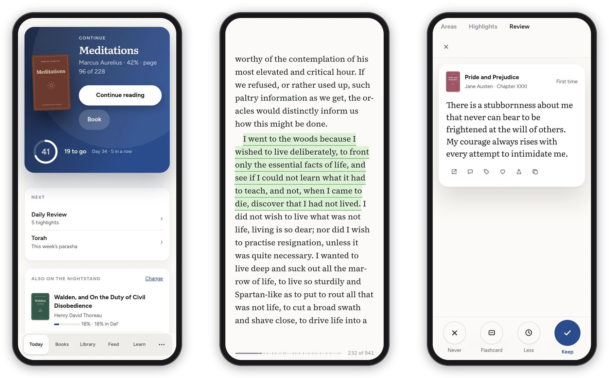
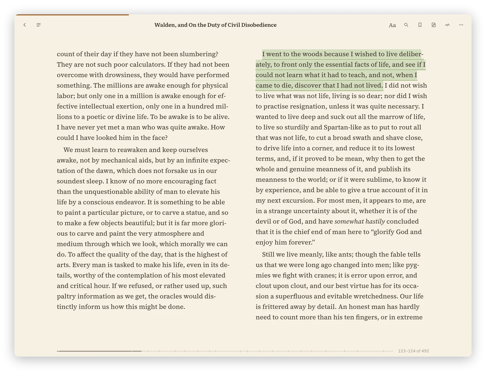

[Daf docs](README.md) › Devices

# The Android app

The Android app is Daf on the phone and the tablet, with the things a web page can't do from inside a browser: the hour on the home screen, "Save to Daf" in the share sheet, the volume keys turning pages, listening with the screen off, books kept on the phone, and the evening nudge. The page inside is the same live site, so everything else in these docs works the same. It needs Android 12 or newer, and you build it from the repository (see [Install](install.md#the-android-app)).

*Today, a book with a highlight, and the daily review on a phone.*

## The app

Daf fills the screen between the status bar and the navigation bar, which both take the background of the theme you picked (in the rooms, the colour of the room's frame, so they run on from the top bar), and it has the bottom bar the phone layout has: **Today**, **Review**, **Feed**, **Library** and **More**. The phone's Back closes whatever is in front first (search, a dialog, the highlight bar, a sheet), then goes to the page before, and leaves the app only when there's nowhere left to go. Links to anything outside Daf open in the browser.

Sign in once inside the app, and it connects itself: the widget, the share sheet and the nudge get a device token of their own, and **Preferences → Account** lists the phone as "Daf for Android" with its model name after it. A phone and a tablet each get their own, so connecting one never cuts off the other.

## On a tablet

On a tablet the sidebar starts as the mini one, a strip of icons in the same groups as the full one, with a line between them (the three lines at the top open the full one), and a book held sideways opens as two pages side by side. On the phone a book is just the page, and one tap in the middle brings its menu (see [The reader](reader.md)).

With an S Pen you can write on articles and books, highlight with the pen and take notes in the margin, and the pen's button opens the round menu of pens: see [Writing with a pen](reader.md#writing-with-a-pen). **[ ]** in a reader's bar puts it on the whole screen, with the status and navigation bars gone and the screen kept on: see [Focus mode](reader.md#focus-mode).

*A book in Pages layout and the Paper theme, at tablet size.*

## The widgets

Daf has seven widgets for the home screen, all of them in the phone's light or dark theme and its Material You colors, and all of them can be made bigger or smaller, showing more as they grow. Long-press an empty spot on the home screen, choose **Widgets**, and they're under Daf, each with a picture of what it will show.

**Today's hour** is a ring of today's minutes with the number in it and "Year 30 · day N" under it. Wider, it adds the day's highlight in a serif face with its book, or "That's the hour." once you're done. Tap the ring for Today and the highlight for Review.

**Keep reading** shows the books you're in the middle of, the nightstand first and then the others you've read lately, each with its cover and a line for how far along you are. Small, it's the first book's cover; wider, a row of covers; taller, a list with the author and where you are, the way Today says it. Tapping a book opens it in Daf's reader right where you left off, or its page when Daf has no file of it.

**Highlight** is one highlight on its own, in a serif face with its book: the day's review first, then the ones you kept in Review. The shuffle button goes on to another one, and that works without a signal too, since twenty come with each refresh. Tapping the words opens Review.

**Spotlight** is one piece with its picture filling the widget and its title over it: what's left in today's Edition first, then the Feed's newest. It moves on every two hours, and two Spotlights side by side show different pieces.

**Edition** is today's Edition as a list, each piece with its source and how long it is, ticked off once you've read it, and how many are done at the top. A piece opens in Daf, and the title opens the Edition.

**Feed** lists the newest unseen headlines with their source, how long ago they were posted and their picture. When you put one on the home screen it asks which part of the Feed to show: everything, a folder, or one feed. Its own settings (long-press it) change that later, so one Feed widget can be the Craft folder and another the whole Feed. The refresh button asks Daf right away.

**Listen** is what Daf's player is playing (an episode, an audiobook or read-aloud) with back, play or pause, and ahead, the same buttons as the lock screen. With nothing in the player it shows the episode you played last, and Play opens Daf and carries on from where you stopped.

The widgets refresh every half hour, when you unlock the phone and when you leave the app, and if Daf can't be reached they keep what they last showed. Their pictures are kept small on the phone. A private book is never named on a widget and never shows its cover.

## Save to Daf

"Save to Daf" is in every app's share sheet. A link, or text with a link in it, goes to the Library. A photo of a page you marked in pencil goes to [Paper pages](paper-books.md#paper-pages-pencil-marks-into-highlights), and Daf opens on it while it reads the lines.

Long-press the app icon for **Review**, **Continue reading** (the first book on your nightstand), **Log paper** and **Settings**.

## Reading on the phone

- **The volume keys can turn pages** in a book: turn on **Preferences → Reader → Volume buttons turn pages** on this device, and then down is the next page and up the one before. While music or read-aloud is playing they change the volume as usual, and they always do when the switch is off. In the manga reader, **Volume keys** in its settings decides.
- **Listening with the screen off:** read-aloud keeps going behind the lock screen, with its controls on the lock screen, in the notification shade and on headphones.
- **Downloads**, like a highlight export or a book's file, go through the phone's save screen, and **Share as image** opens the share sheet.
- You feel a small tap for **Keep** and **Less** in the review and for the bottom tabs.

## Books on the phone

Every book you open in the app stays on the phone, and so do the books you're reading: the nightstand and the last few you read anywhere. A book's **…** menu has **Keep on this device** for any other book you want with you. They open at once and with no signal, and what you do offline (your place, highlights, notes and bookmarks) goes to Daf when the network is back. A book you were only reading leaves the phone three weeks after you last opened it.

The app itself works with no signal too, even from a cold start: it keeps its own copy of Daf's screens and fonts, your lists and the articles you're reading, so it opens straight into Daf instead of an error page. An article's **⋯** menu has **Keep on this device** for one you want with you for good, pictures included (and for a PDF, its pages as printed), and its row in the list gets a small ring so you know it's there. Articles and lists nothing needs any more leave the phone by themselves after three weeks, so it doesn't fill up.

**Settings → Books and manga on this device** shows how much is on the phone and has **Keep the books I'm reading here**, **Download them only on Wi-Fi**, **Update now** and **Remove them**.

## The evening nudge

The nudge is off until you turn it on in **Settings → Evening nudge**. Between 9 pm and 3 am, when Instagram, Reddit, X or Discord is in front, Daf may send one highlight and the minutes you have left. Daf decides, with simple rules: one every 25 minutes at most, and none once the hour is done. It doesn't block anything.

It needs Usage Access, to see which app is in front (**Allow Usage Access**), and permission to post notifications. **Show one now** sends one right away, whatever the rules say, so you can see what it looks like.

## Notifications for new posts

If a feed is set to **Notify me of new posts**, the app checks every 15 minutes and shows a notification for each new post, which opens it in Daf.

## Settings

The app's own **Settings** has **Daf's address** with **Use**, **Connect this phone** and **Forget the token**, **Open Reading Goals**, the books on the phone, and the evening nudge. Everything else is in Daf's **Preferences**, inside the app like in a browser.

If you install the app, put Today's hour or Keep reading on your first screen, which is exactly where they do their job.

Next: [The browser extension](browser-extension.md) →
