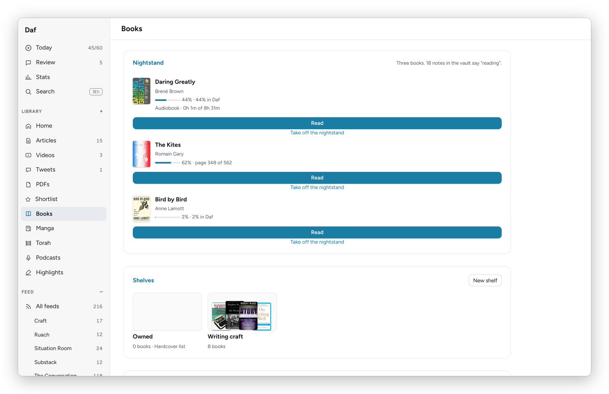
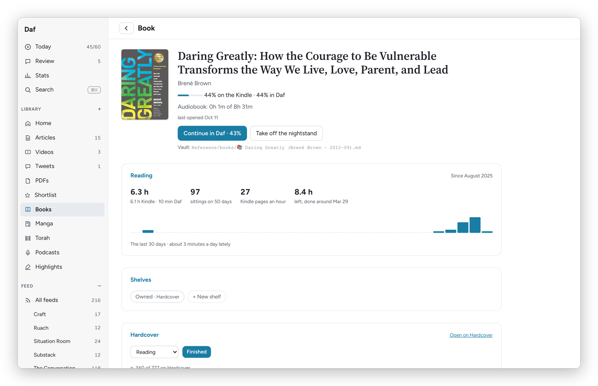

[Daf docs](README.md) › Using Daf

# Books and shelves

This page covers the **Books** page and a book's own page: the nightstand, your shelves, what you want to read next on Hardcover, and everything Daf knows about one book. A book in Daf is one work, whatever form it comes in: the Kindle copies, the EPUB in Calibre, the audiobook and the note in the vault are matched up into one row, so the time and the highlights from all of them land in one place.

## The nightstand

The nightstand is the three books you're reading now. It sits at the top of **Books** and on Today, it decides which books lean into the daily review, and it's what the Kindle's Daf tab and the phone show. Each book has **Read** and **Take off the nightstand**.

Putting a fourth book on asks "Which one steps off?", which is the whole point: three books is a promise you can keep. When you've been reading something that isn't on the nightstand, Today asks whether to **Swap it in**. If the nightstand is empty, Daf suggests three from what you've read lately, with **Use these three**.

*Books: the nightstand, then the shelves.*

## Adding a book

**Add a book**, at the top of **Books**, searches Hardcover by title, author or ISBN. Each result says what I already have of it: "In your library" (Calibre has the file), "In Daf, no file yet", and its Hardcover shelf if it's on one. Study guides and "summary of" knock-offs sink to the bottom, because the results go by how many people read them. Picking one I already have just opens it.

For a new one I choose where it goes on Hardcover (**Want to read**, **Reading**, or **Not on Hardcover**), and I can give it its file right there. Then:

- It's in Daf at once, with its cover, and its Hardcover status is set, privately if the title is on my private list. Its 📚 note in the vault comes from the Hardcover sync within half an hour, the same way as a book added on Hardcover itself.
- The file goes into Calibre through Calibre-Web, which converts it to EPUB and fills in the details from Hardcover. Daf writes the book's Hardcover id and ISBN into the file first, so Calibre ends up with the right book even when it gives it a slightly different title. A few minutes later the book opens in Daf's reader.
- When the file arrives, the book in Daf becomes the Calibre one and keeps everything: its shelves, its place on the nightstand, where I am in it and my notes. It's still one book, not two.
- If Calibre already has the book, Daf says so instead of sending it a second time.

A book without its file has **The book's file** on its page: **Add the file** sends one, and the card says how it's going ("Sent 2 minutes ago", "Calibre has it now", or why Calibre-Web couldn't take it).

## The Kindle

On a book's page, **The Kindle** has **Put it on the Kindle** and a shelf to put it on (Books, Nightstand, Ivrit…, the Kindle's own shelves). The Kindle downloads it on its next Wi-Fi sync. A book still waiting for its file goes once Calibre has it, and **Add a book** asks for the shelf as soon as I give it a file. The card then says where it went and when, with **Send it again**.

## The rest of the Books page

- **Shelves:** your own groups of books, with **New shelf** to make one. A shelf's page has **Rename** and **Delete**.
- **Want to read:** your Want to read shelf on Hardcover, with **Read in Daf** under the ones Calibre has a file for.
- **Opened lately:** the books you've had open recently, on the Kindle or in Daf, each with **Put on the nightstand**.
- **Your library:** every book in Calibre, with a search box for the title or the author, and **Show all** for the full list.

Manga volumes leave this page and live on their own, under [Manga](manga.md).

## Shelves and Hardcover lists

On a book's page, the **Shelves** card has a chip for each shelf, and tapping one puts the book on it or takes it off. **+ New shelf** makes a new one with the book already on it.

Every list you made on Hardcover comes into Daf as a shelf, marked "Hardcover list", and it works both ways: putting a book on that shelf in Daf adds it to the list on Hardcover at once, and the same for taking it off or renaming the shelf. Daf never makes a Hardcover list itself, because lists there can be public, and private books never go up.

## A book's page

Click any book, anywhere, and you get its page.

*A book's page: the time with it, its shelves and Hardcover; the highlights are further down.*

At the top: the progress on the Kindle, in Daf and in the audiobook, when you last opened it, **Read in Daf** (or **Continue in Daf** with the percent), and **Put on the nightstand** or **Take off the nightstand**.

The **Reading** card adds up the time across the Kindle, Daf and the audiobook, the number of sittings and on how many days, how many Kindle pages you read in an hour, and the time left, with a finish date at your recent pace. Under it is a bar for each of the last 30 days.

**A note on this book** is for a thought while reading that isn't about one line. **Save** files it under the book in the vault, the same as a voice note from the Kindle.

The **Highlights** card lists the book's highlights in reading order, under chapter headings, with **Review these**, **Export**, and how often they come up in the daily review: **More**, **As usual**, **Less** or **Never**.

## Hardcover

The **Hardcover** card shows the book's status there: **Want to read**, **Reading**, **Read**, **Paused** or **Did not finish**, and the stars once it's read. **Finished** opens a small dialog with **Your rating** (or **No rating**) and **Finished on**, then **Mark it read**. **Open on Hardcover** opens the book there, and a book Daf can't match gets **Find it on Hardcover** instead.

Daf also keeps Hardcover up to date on its own, and **Preferences → Hardcover** has the two switches for it:

- **Send progress from Daf's reader:** the page you're on in Daf goes to Hardcover every half hour, only forward, and never to a book you finished.
- **Start books as Reading:** a Want to read book you start in Daf moves to Reading.

When the Kindle reaches the end of a book, Today asks whether to mark it read, and at the end of a book in Daf the reader asks the same.

One thing to know about Hardcover itself: it marks a book Read, dated today, the moment you rate it, so Daf only rates books that are already Read.

Next: [The Torah shelf](torah.md) →
