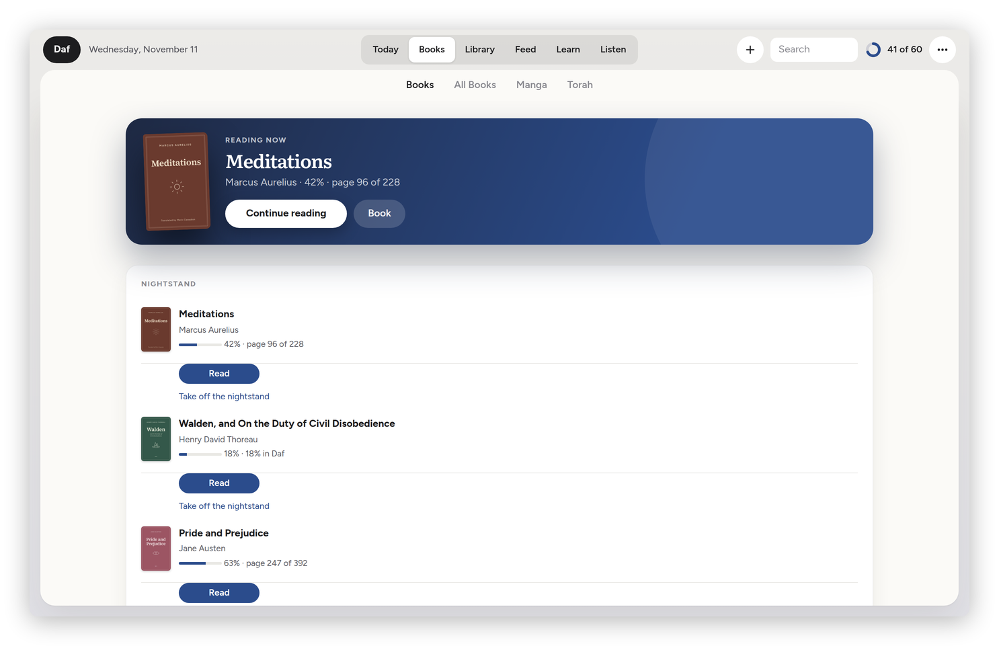
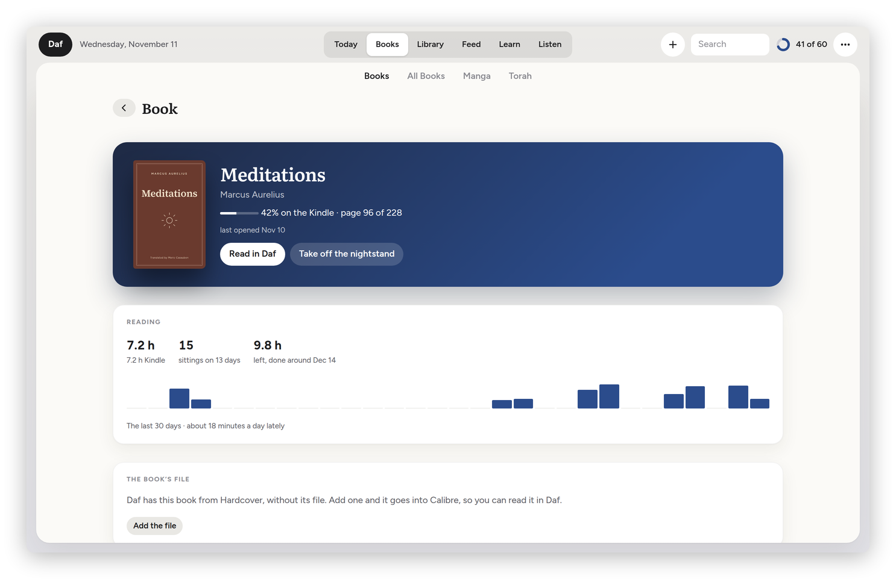

[Daf docs](README.md) › Using Daf

# Books and shelves

This page covers the **Books** page and a book's own page: the nightstand, your shelves, what you want to read next on Hardcover, and everything Daf knows about one book. A book in Daf is one work, whatever form it comes in: the Kindle copies, the EPUB in Calibre, the audiobook and the note in the vault are matched up into one row, so the time and the highlights from all of them land in one place.

## The nightstand

The nightstand is the three books you're reading now. It sits at the top of **Books** and on Today, it decides which books lean into the daily review, and it's what the Kindle's Daf tab and the phone show. Each book has **Read** and **Take off the nightstand**.

Putting a fourth book on asks "Which one steps off?", which is the whole point: three books is a promise you can keep. When you've been reading something that isn't on the nightstand, Today asks whether to **Swap it in**. If the nightstand is empty, Daf suggests three from what you've read lately, with **Use these three**.

*Books: the nightstand, then the shelves.*

## Adding a book

**Add a book**, at the top of **Books**, searches Hardcover by title, author or ISBN. Each result says what I already have of it: "In your library" (Calibre has the file), "In Daf, no file yet", and its Hardcover shelf if it's on one. Study guides and "summary of" knock-offs sink to the bottom, because the results go by how many people read them. Picking one I already have just opens it.

For a new one I choose where it goes on Hardcover (**Want to read**, **Reading**, or **Not on Hardcover**), and I can give it its file right there. Then:

- It's in Daf at once, with its cover, and its Hardcover status is set, privately if the title is on my private list. Its 📚 note in the vault comes from the Hardcover sync within half an hour, the same way as a book added on Hardcover itself.
- The file goes into Calibre through Calibre-Web, which converts it to EPUB and fills in the details from Hardcover. Daf writes the book's Hardcover id and ISBN into the file first, so Calibre ends up with the right book even when it gives it a slightly different title. A few minutes later the book opens in Daf's reader.
- When the file arrives, the book in Daf becomes the Calibre one and keeps everything: its shelves, its place on the nightstand, where I am in it and my notes. It's still one book, not two.
- If Calibre already has the book, Daf says so instead of sending it a second time.

A book without its file has **The book's file** on its page: **Add the file** sends one, and the card says how it's going ("Sent 2 minutes ago", "Calibre has it now", or why Calibre-Web couldn't take it).

## The Kindle

On a book's page, **The Kindle** has **Put it on the Kindle** and a shelf to put it on (Books, Nightstand, Ivrit…, the Kindle's own shelves). The Kindle downloads it on its next Wi-Fi sync. A book still waiting for its file goes once Calibre has it, and **Add a book** asks for the shelf as soon as I give it a file. The card then says where it went and when, with **Send it again**.

## The rest of the Books page

- **Shelves:** your own groups of books, with **New shelf** to make one, and the Kindle's shelves, marked "Kindle". A shelf's page has **Rename** and **Delete**, except for the Kindle's, which I rename and remove on the Kindle.
- **Want to read:** your Want to read shelf on Hardcover, with **Read in Daf** under the ones Calibre has a file for.
- **Opened lately:** the books you've had open recently, on the Kindle or in Daf, each with **Put on the nightstand**.
- **Your library:** every book in Calibre, with **Show all** for the full list.

**All books**, at the top of the page, is the whole library as a spreadsheet, with Calibre's search. It has its own page: [Calibre in Daf](calibre.md).

Manga volumes leave this page and live on their own, under [Manga](manga.md).

## Dragging books onto shelves

Books can be dragged onto shelves, on Books, on a shelf's page and in All books. With a mouse I just drag a book. With a finger or the pen I hold it for a moment until the phone or tablet buzzes, then drag. As soon as a drag starts, **Put on** opens at the side with every shelf: my own, my Hardcover lists and the Kindle's. Under them are Calibre's **Collections**, for a book in Calibre. Dropping a book on a shelf puts it there the same way the book's page would: a Hardcover list changes on Hardcover too, and a Kindle shelf moves or sends the book to the Kindle at its next sync. **New shelf** and **New collection** at the bottom make one and put the book in it. On Books, the shelf tiles themselves take a drop as well. A book only has one collection in Calibre, so dropping it on another one moves it there.

In All books, dragging a row that's one of the chosen ones carries every chosen book, and the label beside the pointer says how many. Holding a row and letting go without moving still opens its menu. For when dragging isn't handy, **Shelves** in the bar at the bottom (and **Shelves and collection** in a row's menu) lists the same shelves to tick. A ✓ means every chosen book is on that shelf and a – means some are, and ticking a ✓ takes them all off.

## Searching my books

The magnifying glass at the top of **Books** opens a search right in the bar. It finds a book by its title, its author, its series in Calibre or the name of a shelf it's on, so "craft" brings up everything on my Craft shelf. Each result says its series and its shelves, with **Read** when Daf has the file. A shelf's own page has the same search for the books on it. × clears it, and Esc, the arrow or the phone's Back closes it.

## Shelves and Hardcover lists

On a book's page, the **Shelves** card has a chip for each shelf, and tapping one puts the book on it or takes it off. **+ New shelf** makes a new one with the book already on it.

Every list you made on Hardcover comes into Daf as a shelf, marked "Hardcover list", and it works both ways: putting a book on that shelf in Daf adds it to the list on Hardcover at once, and the same for taking it off or renaming the shelf. Daf never makes a Hardcover list itself, because lists there can be public, and private books never go up.

## The Kindle's shelves

The Kindle's shelves (the folders on its Shelves screen: Books, Nightstand, Recovery and the rest) are shelves in Daf too, marked "Kindle", with the books that are on them. Every time the Kindle syncs over Wi-Fi it tells Daf what's where, so moving a book on the Kindle moves it in Daf.

It works the other way as well. Putting a book on a Kindle shelf in Daf moves it there on the Kindle at its next sync, with its highlights and its place, the same as **Move to shelf…** on the Kindle. If the book isn't on the Kindle yet, it gets sent there, onto that shelf. Taking a book off a Kindle shelf moves it to the Kindle's home folder, off every shelf. A book is only ever on one Kindle shelf at a time, because on the Kindle it's a file in one folder, so turning on another one moves it.

New shelves for the Kindle are made on the Kindle (**Files ▾ → New shelf here…**), and renamed or removed there too; Daf picks it up on the next sync. My own shelves in Daf stay Daf's.

## A book's page

Click any book, anywhere, and you get its page.

*A book's page: the time with it, its shelves and Hardcover; the highlights are further down.*

At the top: the progress on the Kindle, in Daf and in the audiobook, when you last opened it, **Read in Daf** (or **Continue in Daf** with the percent), and **Put on the nightstand** or **Take off the nightstand**. A book with its audiobook in Audiobookshelf also has **Listen** and **Listen from here** (see below).

The **Reading** card adds up the time across the Kindle, Daf and the audiobook, the number of sittings and on how many days, how many Kindle pages you read in an hour, and the time left, with a finish date at your recent pace. Under it is a bar for each of the last 30 days.

**A note on this book** is for a thought while reading that isn't about one line. **Save** files it under the book in the vault, the same as a voice note from the Kindle.

The **Highlights** card lists the book's highlights in reading order, under chapter headings, with **Review these**, **Export**, and how often they come up in the daily review: **More**, **As usual**, **Less** or **Never**.

## The audiobook

Some of my books are in Audiobookshelf too, and Daf knows which audiobook is which book. Then the two keep each other's place.

- **Listen** on the book's page plays the audiobook in Daf's player from where I am in it, and it says how far that is.
- **Listen from here** starts it where I'm reading instead. In the book itself, the **…** menu has **The audiobook from here**, for the page I'm on.
- When I open the book after listening, Daf says "In the audiobook you're at" and the chapter, with **Go there** and **Stay here**, the same way it offers the Kindle's page.

Where I stop listening goes back to Audiobookshelf as I go, so its app carries on from the same place.

To find the place, Daf first goes by the book's chapters, taking the front matter, the notes and the index out of the count, and guesses how far into the chapter I am. That alone is usually within a few minutes. Then it listens to about twenty seconds of the audiobook there and finds those words in the book, which takes a few seconds, and that puts it within a sentence or so. Every place it finds that way it remembers for the book, so its guesses get closer the more I use it.

When the two don't line up, like an audiobook of a different translation than my EPUB, the words aren't in the book and Daf goes with the chapter guess. That can be a few minutes out, so I listen for a moment and skip. The audiobook's own chapter numbers don't count for much, because they're often its own: the credits or a prologue as "Chapter 1", or a long chapter split in two.

### Reading along with the audiobook

The book's page also has **Prepare the audiobook**. Pressing it has Daf listen to the whole recording once, in the background, and write down where every sentence is in the book. It runs at the lowest priority so nothing else on the server waits for it, one book at a time, and it takes about seven or eight minutes for every hour of audio, so a long novel is ready in a couple of hours. The button shows how far along it is, and if the server restarts in the middle it picks up where it stopped.

Once it's done, **Listen** in the book itself plays the real audiobook instead of the generated voice. It starts from the page I'm on, the sentence the narrator is reading is marked the same way the voice marks it, and the page turns with the narrator, into the next chapter too. The timing is within about half a second of the narrator, which is close enough that the mark moves with the voice. If I tap a sentence while it plays, the audiobook jumps there. If I turn back a page to look at something, Daf leaves me there for a few seconds and then catches up again. Pausing and closing keep my place in the book and in Audiobookshelf, the same way **The audiobook from here** does, and when I open the book again while it's still playing, the page follows it without asking.

The listening time counts once, as Audiobookshelf's listening time, so Daf doesn't also count those minutes as reading.

If I'd rather have the voice for a book even though its audiobook is ready, **Themes & Settings** has **Listen** with **Audiobook** and **Voice**.

Bits of the recording that aren't in the book, like the opening credits, music or a foreword the EPUB doesn't have, simply get no mark, and Daf goes back to marking as soon as the narrator is back in the text. An abridged recording works too: when the narrator skips ahead, Daf finds where they went on and keeps going from there. A recording of a different translation is the one thing it can't do, because the sentences aren't the same words. Daf checks for that first, by listening to a few places across the recording, and then the button says **The audiobook is another text** instead of spending hours on it. Listen stays the voice for that book, and the chapter guess above still works for finding my place.

## Hardcover

The **Hardcover** card shows the book's status there: **Want to read**, **Reading**, **Read**, **Paused** or **Did not finish**, and the stars once it's read. **Finished** opens a small dialog with **Your rating** (or **No rating**) and **Finished on**, then **Mark it read**. **Open on Hardcover** opens the book there, and a book Daf can't match gets **Find it on Hardcover** instead.

Daf also keeps Hardcover up to date on its own, and **Preferences → Hardcover** has the two switches for it:

- **Send progress from Daf's reader:** the page you're on in Daf goes to Hardcover every half hour, only forward, and never to a book you finished.
- **Start books as Reading:** a Want to read book you start in Daf moves to Reading.

When the Kindle reaches the end of a book, Today asks whether to mark it read, and at the end of a book in Daf the reader asks the same.

One thing to know about Hardcover itself: it marks a book Read, dated today, the moment you rate it, so Daf only rates books that are already Read.

Next: [The Torah shelf](torah.md) →
