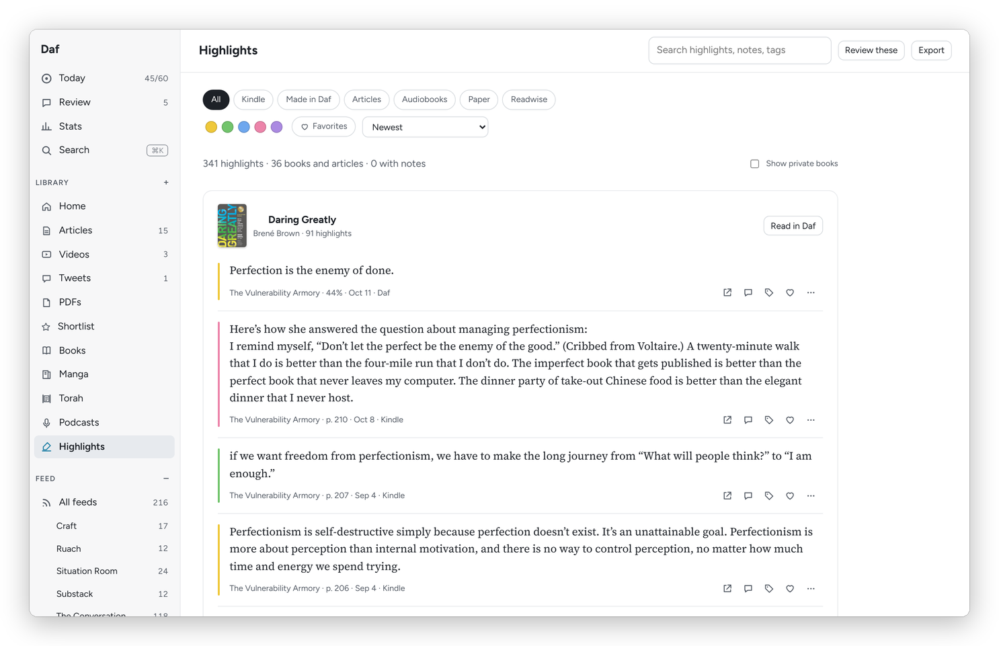

[Daf docs](README.md) › Using Daf

# Highlights and review

This page is about the part of Daf I'd miss most if it disappeared: every highlight in one place, and a few of them coming back every day. It covers making highlights, the Highlights page, the daily review, flashcards, and where it all ends up in the vault.

## Where highlights come from

- **The Kindle**, from KOReader's notes for each book, which reach the server with the books.
- **Daf itself**, in books, articles, PDFs and video transcripts.
- **The browser extension**, on any web page.
- **Karakeep**, when you highlight in its own reader.
- **Audiobooks and podcasts**, transcribed from a bookmark or a shared position.
- **Paper pages**, from photos of the lines you marked in pencil.
- **Readwise**, the years before Daf, read from the Readwise exports in my vault.

## Making a highlight

With a mouse, selecting more than one word highlights it right away, like Readwise, and selections grow to whole words. Hold Alt (⌥ on a Mac) to select without highlighting. On a touch screen, or when **Auto highlight** is off, a small bar comes up instead with **Highlight** (h), **Highlight with a note** (n), **Ask about this** and **Copy**, and **Define** or **Translate** when you've selected a single word or a Hebrew phrase.

Once it's a highlight, the bar changes: the colored circle removes it (with Undo for a few seconds), then **Add a note**, **Tag it**, the five colors (yellow, green, blue, pink and purple), and **…** for **Copy text**, **Share as image**, **View in notebook**, **Favorite** and **Make a flashcard**. A Kindle highlight shows "Kindle" where the remove button is, because it belongs to the Kindle.

On a phone the bar keeps clear of the selection handles, so a tap on it never lands on a handle instead. In the Android app it's the only menu, since Android's own Copy and Select all bar stays away while a book or article is open, and it sits over the words. In a phone's browser, whose own menu takes that spot, it sits well under them. A tap anywhere on the page puts the bar away and does only that, so it doesn't turn the page too.

*A sentence just highlighted, with the colors above it.*

A word with a dot in a note becomes a tag, as in Readwise: ".craft" in a note tags the highlight "craft". Highlighting over an existing highlight merges them, and the note, tags and review history come along.

## Open at the exact spot

Every highlight opens where it is. Press the small arrow next to a highlight on the Highlights page or a book page, click it in the Notebook, or press o in the review, and the book or article opens at that line, and the spot flashes. That works for the Kindle's highlights in books Calibre has, for Daf's own, and for audiobook and paper highlights, which Daf finds by their words.

## The Highlights page

**Highlights** in the sidebar shows them all, grouped by book or article. At the top:

- a search box for the text, notes, tags and titles;
- source chips: **All**, **Kindle**, **Made in Daf**, **Articles**, **Audiobooks**, **Paper** and **Readwise**;
- the five colors, **Favorites**, and the order (newest, by book in reading order, or oldest);
- **Review these**, which turns whatever the filters show into a review of its own;
- **Export**: **Markdown, by book**, **CSV (spreadsheet)** or **JSON** of what the filters show, and **Flashcards for Anki**.

*The Highlights page, with the color and source filters.*

Each highlight's **…** has the colors, **Make a flashcard**, **Copy text**, **Share as image**, **Open at this spot** and **Never show in review**, and for a highlight made in Daf (in a book, an article or a paper page) **Delete highlight**. A picture has no **Share as image** or flashcard.

## The daily review

**Review** shows today's highlights one at a time, five a day unless you change it in **Preferences → Daily review**. Daf picks the ones that are due first, then new ones, leaning toward the books on your nightstand and what you highlighted lately, with at most two from one book. Favorites come up twice as often, and private books never.

For each one:

- **Keep** (k or →): it comes back in four days, then each time two and a half times later.
- **Less** (l): it goes away for four months or more.
- **Never** (x): out of the review for good. "Back into review" undoes it.
- n writes a note, o opens it at its spot, and f makes it a favorite.

On a phone, swipe right to keep and left for less often. A note you write goes into the vault under that highlight. When you're done, Daf says so, with your review streak, and **Review more highlights** gives you another round.

A book's page can make its highlights come up **More**, **As usual**, **Less** or **Never**, and there are themed reviews too, of one tag, one color, your favorites or one book.

The first highlight of the day also comes to my phone every morning, through my Signal bot, and a reply that starts with "n:" becomes its note (see [Sharing, messages and the widget](phone-shortcuts.md)).

## Flashcards

Some highlights are facts I want to actually remember, and for those there are flashcards, like Readwise's Mastery. **Make a flashcard** gives you **Fill in the blank** (tap the words to hide) or **Question** and **Answer**, and **Suggest a card** asks Claude to write one for you. Due cards come after the day's highlights in the review: Space shows the answer, then 1 **Again**, 2 **Hard**, 3 **Good** or 4 **Easy**, and the interval grows like Anki's. Up to five new cards come in a day.

## Share as image

**Share as image** makes a card of the quote beside its color, with the title and author, for sending to someone. **Share…** opens the system's share sheet where there is one, and **Download** saves the picture.

## Into the vault

Daf writes highlights and notes into my Obsidian vault, which is the real record. A book's highlights go into its note, between two markers that are Daf's alone, and an article's go into a note in `Reference/clippings`, in the same format my Readwise clippings already had. If I edit that part in Obsidian, my edit wins. Basically, Daf is the reading room and the vault is the library, and none of my highlights or notes live only in Daf.

Next: [Books and shelves](books-and-shelves.md) →
