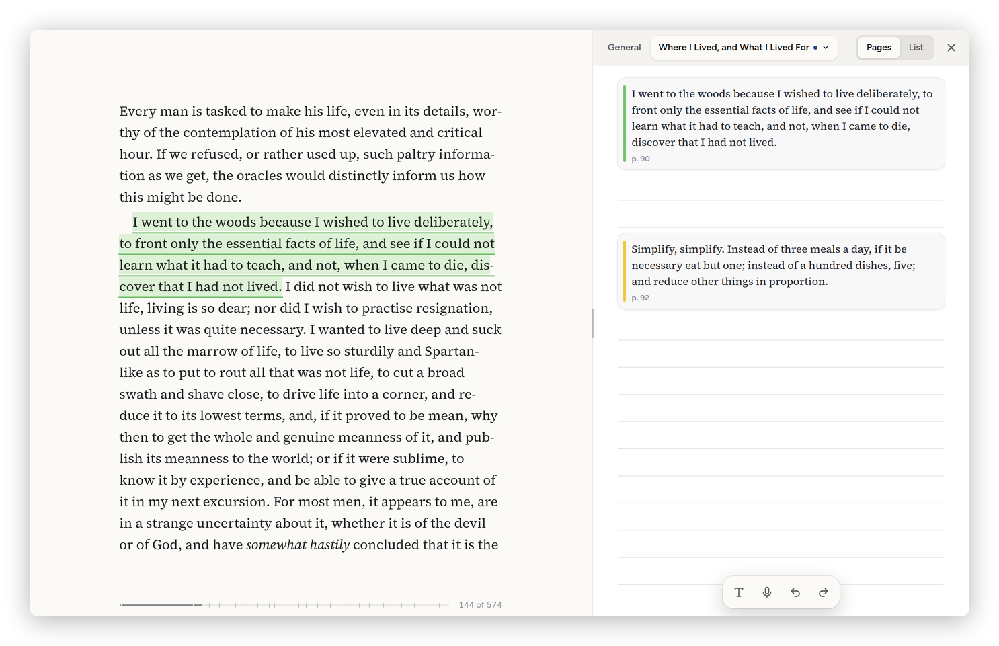
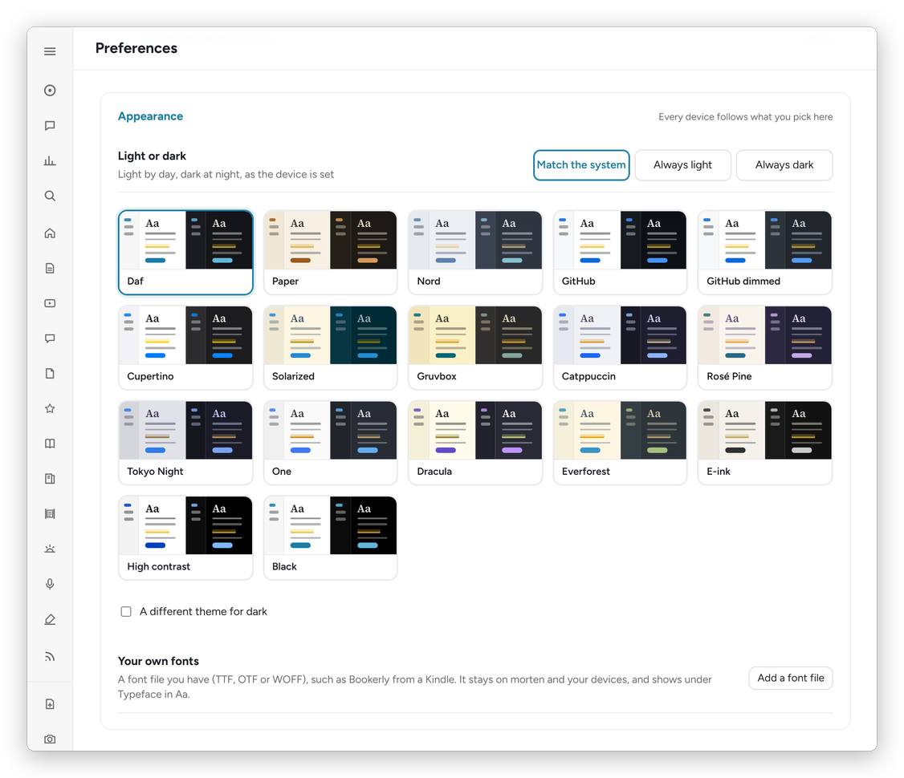
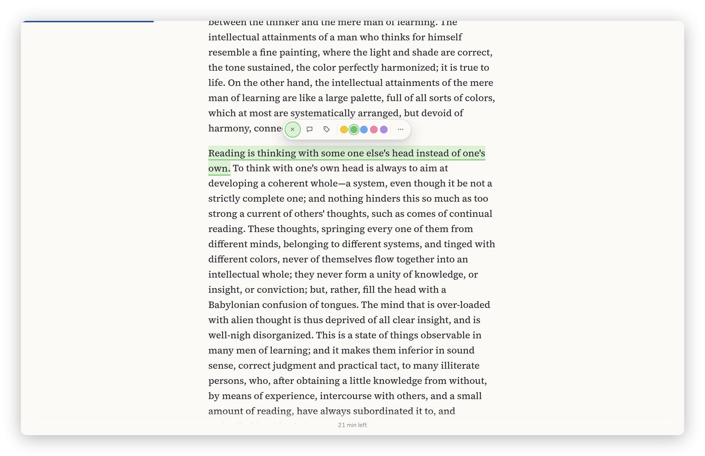

[Daf docs](README.md) › Using Daf

# The reader

Daf's reading view is where books, articles and PDFs open. Whatever I'm reading takes the whole window: the sidebar goes away (⌘\\ brings it back for a moment; on a tablet the left edge belongs to the page, so a swipe there turns back a page and doesn't bring the sidebar), and the bar on top is short and gets out of the way once I start reading. The contents, [the Notebook](sketchbook.md) and a side panel with **Info** and **Ask** are there when I want them. This page covers books first, then what's different for articles and PDFs, then Listen, looking words up and the keys.

*A book in Daf, with the Notebook open on the right and the chapter's highlights on its page.*

## Books

Every book in my Calibre library with an EPUB, KEPUB, AZW3, MOBI, FB2 or CBZ file opens in Daf. On a book's page press **Read in Daf**, or **Continue in Daf** with the percent once you've started. The reader is foliate-js, the engine inside the Foliate e-reader. A book Calibre only has as a PDF opens on its pages as printed instead, the way a PDF does (see [PDFs](#pdfs)), and it's still the book: my place, my highlights and my minutes go to the book, and it opens where I left it on any device.

Your place is kept per book on the server, so the phone and the desk agree, and the newest place wins when you open it ("Picked up at 45%"). If the Kindle is further along, Daf says "On the Kindle you're at page 212 of 480", with **Go there** and **Stay here**.

A book reads the way it does in Apple Books. On a wide screen it opens as two pages side by side, like a real book, and on a phone as one. The bar has back and **Contents** (t) on the left, the title in the middle, then **Aa**, **Search** (/), the bookmark ribbon (b) and the **…** menu, and it fades as soon as I turn a page. Moving the pointer to the top or the bottom brings it back. The contents and the side panel slide in over the pages and go again with a tap outside them. Under the pages is the [status bar](#the-status-bar), with the page number, and that one stays.

On a phone the page is all there is: no bar, just the status bar at the bottom. One tap in the middle brings ✕ with the title and the author at the top, and at the bottom a slider to go anywhere in the book and a round button. That button opens one menu with **Contents**, **Notebook**, **Search Book**, **Themes & Settings**, **Listen** and **Ask about this book**, and under them the bookmark, focus mode and the full **…** menu. Tap the middle again and it's just the page.

A book that's only pictures of its pages, like a scanned book someone turned into an EPUB, reads like the printed one: each picture is a page as big as the screen allows, and sideways two of them face each other with the odd pages on the right. Double-tap or pinch a page to read it up close, drag it around, and tap or pinch back out to put it away. If the pages come in the wrong pairs, **Pair the pages the other way** in the **…** menu swaps them.

Footnotes open in a small popover next to the link, so you never lose your place. The screen stays awake while a book is open. Near the end of a book in a series, Daf offers the next one (**Start it**), and at the very end it asks "The end. Mark it read on Hardcover?" with **Finished** and **Not now**.

The **…** menu has **Listen from here** (l), **The audiobook from here** when the book has one in Audiobookshelf ([Books and shelves](books-and-shelves.md#the-audiobook)), the **Notebook** (]), **About this book**, **Ask about this book** and **Focus mode** (f), then **Go to the beginning**, **Go to a page or a percent** (type 120 for a page, or 45%), **Go to the Kindle's page**, **Bookmark this page**, **Book page, notes and nightstand**, **Export highlights (Markdown)**, **Download the file**, **Auto highlight**, **Keyboard shortcuts** and **Forget my place in Daf**. In the Mac and Android apps it also has **Keep on this device**.

## How the page looks

**Aa** opens **Themes & Settings**, the same for books and articles. On a phone it comes up from the bottom of the screen.

- **The two A's** make the text smaller or bigger, and a book has **Pages** or **Scroll** beside them. Pages is how a book opens unless I've picked Scroll on that device.
- **Six looks to tap:** Daf, Paper and E-ink for the day, Dusk, Night and Black for the night. A day look sets the theme Daf uses in light mode and a night look the one for dark mode, so with **Auto** the page still follows the system. **All themes** opens Preferences → Appearance for the other eighteen, the rooms among them.
- **Auto, Light or Dark:** when light and dark apply.
- **Font** opens the typefaces:
  24 faces in groups, each shown in itself:
  - **Serif:** Source Serif, Literata (the free cousin of Bookerly, made for Google's e-reader), Charis (Charter), Merriweather, Lora, EB Garamond, Crimson Pro, Newsreader, Spectral, Libre Baskerville, Alegreya, Vollkorn, IBM Plex Serif and Bitter.
  - **Sans:** Figtree, Inter and Source Sans.
  - **Easier to read:** Atkinson Hyperlegible, Lexend and OpenDyslexic.
  - **Hebrew:** Frank Ruhl Libre, Noto Serif Hebrew, David Libre and Heebo.
  - **Yours:** any font you've added.
  - **For books:** the book's own.

  They all come from Daf itself, so they work offline too.
- **Page turn**, for a book in Pages: **None**, and the next page is just there; **Slide**, and the page slides away as the next one comes in beside it; **Curl**, and the page lifts at its corner and turns over like paper, with the next one underneath. With two pages open the right one turns over onto the left, and a Hebrew book turns the other way. Taps, swipes, the arrow keys and the volume buttons all turn it, a page for each, even in quick succession. A swipe holds the page under my finger: let go past about a third of the way, or with a flick, and it turns; short of that it falls back. If I hold the page still before letting go, it goes whichever way it's nearer, and if Android takes the swipe away halfway (its Back gesture from the edge does that), the page settles on a whole page instead of staying stuck between two. It's this device's choice, the same for every book, and if the system asks for reduced motion the pages just turn.
- **Spacing, margins, justify:** **Font size**, **Line spacing**, **Line width** (Narrow, Medium, Wide), and for books **Justify the text**.

**Just for this book** keeps a book's own typeface, size and layout, while the theme and the page turn stay the same everywhere.

For a book there's also **Status bar**, below.

Whether the time counts toward your hour isn't shown over the text any more; Today and Stats say it.

## The status bar

Under a book's pages is a status bar like KOReader's, and it stays there while I read, in focus mode too. Out of the box it's set up the way KOReader is: one thing at a time, starting with the page number ("64 of 196"), and a tap on it goes on to the next: the clock, the pages left in the chapter, the battery (in the Android app and in Chrome), the percent, the time left in the book and the time left in the chapter. Beside it is a thin line for the whole book, with a small mark where each chapter starts.

A page is what KOReader calls a page. When the EPUB has the printed book's page numbers, it's the printed page. Otherwise it's the pages as they are on my screen, counted through the whole book: two pages side by side are two pages ("111–112 of 349"), and in Scroll a page is a screen's height. A bigger font or turning the tablet changes how many there are, so Daf counts the book again in the background, and it remembers the count on the device so that only happens the first time.

**Themes & Settings → Status bar** sets it up (holding a finger on the bar opens it too):

- **Off**, **One at a time** or **All at once.** All at once puts everything on one line with dots between them, and then a tap on the bar opens these settings.
- **Progress bar:** **Off**, the whole **Book**, or the **Chapter** I'm in.
- **What's on it, in order:** **Page**, **Page in chapter**, **Pages left in chapter**, **Pages left in book**, **Percent**, **Time left in chapter**, **Time left in book**, **Chapter**, **Book title**, **Clock** and **Battery**. The dark ones are on, in the order they come in; tap one to take it off, or to put it back on at the end.

It's the same for every book. When I've picked more than fits on one line, the progress bar makes room first, and then a long chapter title gets cut short.

## Themes and your own fonts

**Preferences → Appearance** picks the colours for all of Daf:

- **The themes:** Daf, Paper (sepia), Nord, GitHub, GitHub dimmed, Cupertino, Solarized, Gruvbox, Catppuccin, Rosé Pine, Tokyo Night, One, Dracula, Everforest, E-ink, High contrast, Black (for OLED screens) and Absolute: pure black on white, or pure white on black, with no grey text or lines anywhere. Each one has a light and a dark version, and the card shows both. Choose Absolute for light, for dark, or both.
- **The rooms:** four themes that are a place as well as colours. **Wood bookshelf** is oak shelves in a walnut frame, and walnut and ebony at night. **Rustic library** is oxblood leather stitched at its edges, brass and parchment, and dark leather at night. **Gothic library** is stone walls in courses, crimson and gold, with headings in Vollkorn: night stone after dark, pale limestone by day. **Cyberpunk library** is neon on a night grid with scanlines on the bars, and by day a bright terminal with the same neon. In each the sidebar, the top bars and a book's footer are made of that material, the screen behind the cards is a wall of it, and the books on Books and in the Library stand on shelves. What I read stays on a plain page in the room's colours, so it reads as calmly as any other theme.
- **Light or dark:** Match the system (light by day, dark at night, as the device is set), Always light, or Always dark.
- **A different theme for dark:** for example GitHub by day and Nord at night.
- **Your own fonts:** add a TTF, OTF or WOFF file you have, such as Bookerly from a Kindle. Bookerly is Amazon's, so Daf can't ship it, but a copy you add stays on the server and your devices. It then appears under **Yours** in Aa, for articles and books alike.

The choice is kept on the server, so every device follows it.

*The themes, each card with its light half and its dark half.*

## The side panel

The highlights and my notes on them are in [the Notebook](sketchbook.md), beside the book, with a page for each chapter and a list of everything: every highlight in the book in reading order, from Daf, the Kindle, the audiobook and paper pages. Tapping one takes the book there. The side panel has the rest:

- **Info:** the cover, the description, and the details, including the series and where the Kindle is. In an article it also has the document note and where it is in the vault.
- **Ask:** a question about where you are, like a name you've forgotten or an argument you lost track of. Claude answers from the pages around you, briefly and without spoiling what comes later, on my own subscription. Ask has ready questions, like **Summarize this** in an article and **Who is this?** in a book.

**Preferences → AI** decides how all of this talks to the model: the ready questions, the prompt behind each thing (summaries, Ask in an article and in a book, a word in its sentence, flashcards), which model (Opus, Sonnet or Haiku), and whether new articles get a summary on their own. Each prompt starts as Daf's, and **Daf's own** puts it back.

## Articles

Articles from the Feed and the Library open in the same view. Click a picture to highlight it: it gets a frame in the color, and it shows as the picture in the Notebook, Highlights, the review and the vault. Hebrew titles and paragraphs read right to left on their own.

The bar has six things on it: back, **Aa**, **Listen** (p), **Done** (e), the **…** menu and the notebook (]). A Feed item has **Save to Library** (s) too. It slides away while I read on, and comes back when I scroll up a little or move the pointer to the top, with the title in the middle once the heading has gone by. Under the text, quietly, is how many minutes are left.

The article **…** menu has the next and previous item of the list I came from (Shift J and Shift K), **Shortlist** (f), **Focus mode** (Shift F), **Add a document note**, **Read aloud from here**, **Ask about this**, **Load the full article** (for feeds that only send a summary), **Send to the Kindle**, **Keep on this device** (in the apps), **Save to Library** and **Mark seen** for a Feed item or **Read later** and **Archive** for a Library one, **Reset reading progress**, **Edit title and author**, **Delete**, **Open the original**, **Copy the link**, **Open the note in Obsidian** and **Keyboard shortcuts**.

*Selecting a sentence highlights it, and the bar above it changes the color, adds a note or tags it.*

## Writing with a pen

On a tablet with a pen (the S Pen on a Galaxy Tab, or an Apple Pencil on an iPad) you can write straight on an article or a book, the way you'd write in the margins of a paper one. The pen writes and your fingers scroll and select, so there's no mode to switch. It works in the Android app and in the browser. The pen's tools show on the right of the screen the first time the pen touches the page:

- **The pen.** Seven kinds, as in Samsung Notes: fountain pen, calligraphy pen, pen, pencil, calligraphy brush and marker. Tap the pen again for its kinds, its size (1 to 100), its opacity and its colour: the text's own colour (white on a dark theme), fifteen others, or any colour at all, and what an underline does (see Underlining below). Each kind keeps its own size, colour and opacity, and the line gets thicker the harder you press.
- **Highlighter.** Drawn along a line of text, it highlights those words, as selecting them does, so the highlight is in the Notebook, Highlights and the review like any other. Drawn down a few lines, it highlights from where you started to where you stopped. Anywhere else, like a ring around a paragraph or a stroke in the margin, it stays a highlighter's stroke. Its colour is your highlight colour.
- **Eraser.** Tap it again to choose whether it takes whole strokes or only what it passes over, and how big it is. It also takes away any highlight it passes over. **Erase everything written here** is there too, with Undo.
- **Lasso.** Draw round handwriting to hold it, then **To text** or **Erase**. Tap the lasso again for **Read all the handwriting here**.
- **Undo** and **Redo**.
- **Margin** (articles) moves the text over to leave room on the right for notes. It comes on by itself in an article that already has notes in its margin.
- **›** puts the tools away, and then the pen scrolls and selects like a finger. The pen button brings them back.

**The S Pen's button.** Press it and let go with the pen just over the screen, not touching, and the round menu opens where the pen is, as in Samsung Notes. The pen you're holding is in the middle (tap it for the other kinds, the highlighter and the eraser), its size is on the left, its colour on the right, Undo and Redo are at the top, and your favourite pens are at the bottom, with **+** to keep the pen you're holding as a favourite. Hold the button while you write and the pen erases.

**Shapes.** Draw a line, a circle, a rectangle or a triangle and hold the pen still for a moment at the end, and it comes out clean.

**Underlining.** Underline some words with the pen, just under them or through the bottom of the letters, and they're highlighted, as selecting them does, so the highlight is in the Notebook, Highlights, the review and the vault like any other. Underline a few lines one after the other and they make one highlight. It takes the highlight colour nearest the pen's (red makes pink, orange yellow, teal green), and with black, grey or the text's own colour it's my usual highlight colour. "Highlighted" comes up at the bottom, and **Undo** there brings my line back as ink. A line that's slanted or a bit wobbly still counts. Writing, a ring round a word, an arrow, a tick in the margin or a line in the margin stays ink, and so does a line I draw while I'm writing something by hand: when Daf isn't sure it's an underline, it leaves the ink alone.

**Underline** in the pen's panel (tap the pen again) says what an underline does: **Highlight**, **Ask** (the line stays and a small **Highlight** button comes up by it, gone again once I touch anything else) or **Ink** (it stays a line).

**Handwriting into text.** **To text** reads what the lasso holds, and a card shows it to fix:

- **Note on the passage**: the sentence beside your handwriting is highlighted (or the highlight that's already there is used) and the text becomes its note, so it's in the Notebook, Highlights, the review and the vault. The handwriting stays.
- **Typed, in its place**: the handwriting turns into typed text, where it was and about its size.
- **Copy**.

English is read on the device by Grape, the reader FineNotes uses, in Daf itself, so it works in the browser too and offline once its 5.7 MB model has come. Hebrew is read by Google's handwriting reader in the Android app (0.5.2 and later), which it fetches from Google once, about 20 MB; pick **עברית** on the card. Lines drawn clean as shapes and the highlighter's strokes aren't read.

For notes beside the page instead of on it, there's [the Notebook](sketchbook.md).

While the pen is over the screen, a small ring shows where it'll write and how wide. A hand resting on the screen while you write doesn't scroll the page or turn it. What you write is kept on the server, so it's there on every device, and each stroke stays with the words it was written on: change the font size or the line width and it moves with them, and a note in the margin stays beside its paragraph. Written with no signal, it waits on the device and goes when you're back online, as highlights do. Writing on a Feed item saves it to the Library, as a highlight does.

## Focus mode

**Focus mode** in the **…** menu of an article or a book (the **[ ]** button in a PDF's bar) puts it on the whole screen: the sidebar and the bar go (a book's status bar stays), and in the Android app the status and navigation bars go too and the screen stays on. In a browser the window goes full screen. The edges bring back what you need:

- **The top or bottom edge:** the bar, with Aa, the contents, the side panel and the rest. It goes again after a few seconds, or when you touch the page. In a book, a tap in the middle of the page does the same; the status bar at the very bottom does its own thing when tapped (see [The status bar](#the-status-bar)), and on a phone the slider and the round button come with the bar.
- **The left edge:** the contents.
- **The right edge:** the side panel, with Info and Ask.

Focus mode stays on for the next thing you open until you leave it from the **…** menu, Esc, or F (Shift F in an article). The pen's tools are hidden while you're in it; the S Pen's button still opens the round menu.

## PDFs

A PDF opens as text first, which reads like an article and reflows on a phone. **Pages** opens it as printed, with pdf.js, drawn page by page with a text layer you can select and highlight. Highlights made on the page show in the text view too when their words are there, and the other way around. A book Calibre only has as a PDF opens straight onto its pages.

On the pages it works the way Preview and Acrobat do. The button beside Back (t) opens the side panel. **Pages** has every page as a small picture, with a dot under the ones I've highlighted, and the grid button next to the tabs (Shift G) spreads them over the whole screen, as many across as fit. **Contents** is the PDF's own table of contents, with the chapter I'm in marked. **Highlights** lists mine in page order, and **Search** (/, or ⌘F) finds a word or a phrase on every page, a few words around each, and marks them on the page. On a wide screen the panel stays beside the pages; on a tablet upright or a phone it comes in over them and goes once I've picked a page. In focus mode it's the drawer from the left edge, and the bar from the top edge has the same button, so all the pages and the contents are one tap away there too.

The page number in the bar (g) goes to a page: type a number, or the page number printed on the page when the PDF has them (a scanned book's page 315 might be the PDF's 319, and Daf knows), or drag the slider. ← and → turn a page, and so do the volume buttons when **Volume buttons turn pages** is on, and a sideways swipe when the pages aren't wider than the screen.

The view menu next to Search has the zoom (+ and −, or pinch with two fingers, or ⌘ and the wheel on a Mac), **Fit the width** or **The whole page** (0 switches between them), **Scroll** or **Page by page**, where each page fills the screen and settles in the middle, **One page** or **Two pages** side by side (a book's cover alone first, as a printed book opens), **Dark pages** for night reading, and **Download the PDF**. How it's set is this device's, for every PDF.

## Listen

**Listen** reads the book or article aloud with Kokoro, a voice that runs on my server, a paragraph at a time, and marks the sentence it's on. Reading aloud counts toward today the whole time it plays. It plays in Daf's player along the bottom of the screen, the same one podcasts use, so it keeps reading when I go somewhere else in Daf or leave the app, and a book goes on into the next chapters by itself. The bar has the previous and next paragraph; tapping it opens the whole player with the speed, the voice, a **Sleep timer** from 15 to 60 minutes for books, and **Go to it**, which opens the book or article at the paragraph it's reading. The player's voice button (it shows the voice's name, Heart to start with) lists Kokoro's English voices, American and British, clearest first. Press ▶ next to one to hear a line in it, and press its name to switch; the paragraph starts again in the new voice. The voice and the default speed are also in **Preferences → Reader**.

## Looking things up

Select a single word and the bar shows **Define**: Hebrew words come from Sefaria's dictionaries (BDB, Klein and Jastrow), English ones from Wiktionary. Select a Hebrew phrase and it shows **Translate** instead. "In this sentence" explains what the word means right there, which takes about ten seconds.

## Keys

| Books | | Articles | |
|---|---|---|---|
| ← → | previous / next page | j / k | next / previous paragraph |
| Space | next page (Pages) | h | highlight the paragraph or selection |
| h | highlight the selection | n | highlight with a note |
| n | highlight with a note | l / e | Later / Done |
| b | bookmark this page | s | Save to Library (Feed) |
| t | contents | f | Shortlist |
| / | search in the book | o | open the original |
| ] | side panel | [ / ] | contents / side panel |
| l | listen | Shift L | read aloud |
| f | focus mode | Shift F | focus mode |
| Esc | close | Shift J / K | next / previous in the list |
| | | d / z | delete / undo |
| | | t | tags |

In a PDF: ← → turn a page, t the side panel, Shift G all the pages, g go to a page, / search, + and − zoom, 0 fit the width or the whole page, h highlight the selection.

Everywhere: ⌘K searches everything, ? shows the keys for where you are, and holding Alt (⌥ on a Mac) while you select selects without highlighting.

**Preferences → Keyboard** changes any of them: click a shortcut and press the key you want, and every "Keyboard shortcuts" sheet follows. With a Hebrew keyboard on, the keys still work by where they are on the keyboard, so h is still the key under your finger.

## Offline, and fast

Daf keeps itself on the device: its screens come from there at once, every list and page shows what it had a moment ago and then catches up, and a cover, a manga page or a book you've opened before comes from the device instead of the server. A book downloads the first time you open it and then never again, unless it changes in Calibre. When Daf itself is updated, an open page notices within half an hour and loads the new version at a calm moment: the next time you go somewhere outside a reader, or come back to Daf after a while away, and never while something is playing or half typed.

On an https address, every book and article you've opened before opens again with no signal, and opening the Library quietly saves the text of up to 30 Inbox and Later articles. What you do offline, your place, highlights, notes and bookmarks, waits on the device and goes to Daf when the network is back, with the time you did it.

Next: [The Feed and the Library](feed-and-library.md) →
