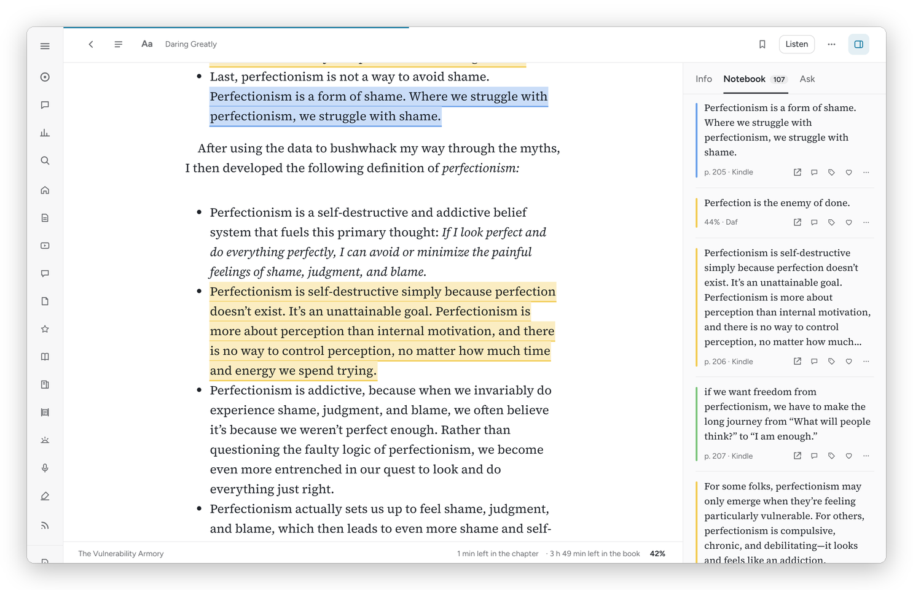
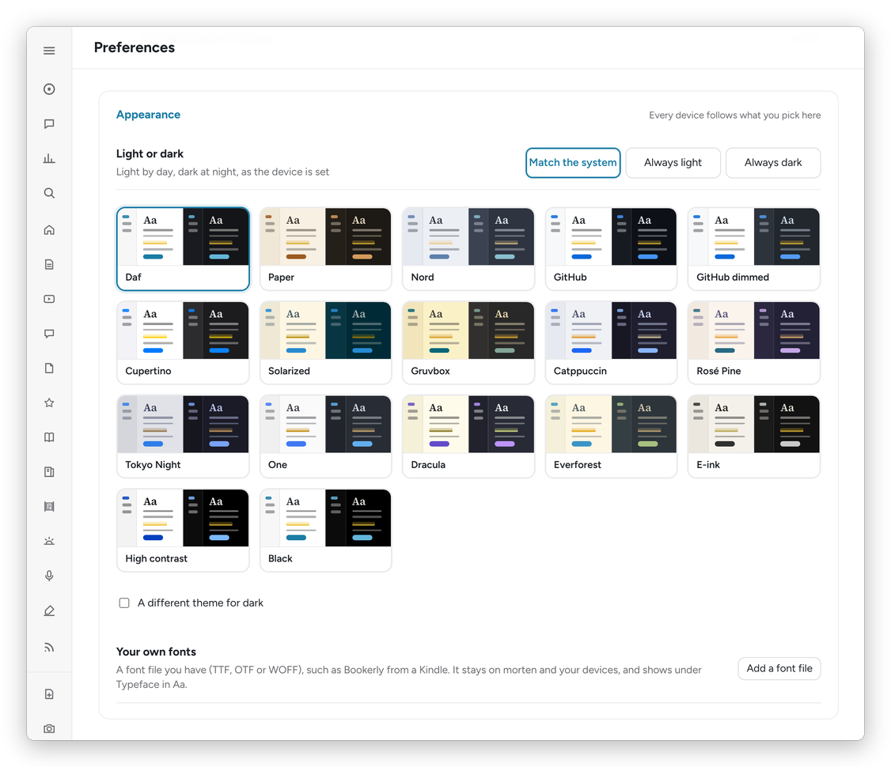
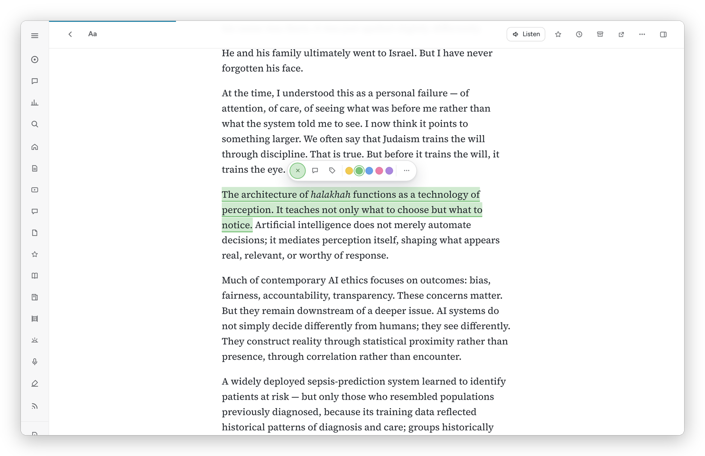

[Daf docs](README.md) › Using Daf

# The reader

Daf's reading view is where books, articles and PDFs open, and it works the same way for all three: the text in the middle, contents on the left, and a side panel on the right with **Info**, **Notebook** and **Ask**. This page covers books first, then what's different for articles and PDFs, then Listen, looking words up and the keys.

*A book in Daf, with the Notebook open on the right.*

## Books

Every book in my Calibre library with an EPUB, KEPUB, AZW3, MOBI, FB2 or CBZ file opens in Daf. On a book's page press **Read in Daf**, or **Continue in Daf** with the percent once you've started. The reader is foliate-js, the engine inside the Foliate e-reader.

Your place is kept per book on the server, so the phone and the desk agree, and the newest place wins when you open it ("Picked up at 45%"). If the Kindle is further along, Daf says "On the Kindle you're at page 212 of 480", with **Go there** and **Stay here**.

The top bar has, from the left: back, **Contents and search** (t), **Aa**, the bookmark ribbon (b), **Listen**, the **…** menu and the side panel. The footer has the chapter, the minutes left in it and in the book, the printed page when the EPUB knows it, and the percent. Tap the percent to jump anywhere.

Footnotes open in a small popover next to the link, so you never lose your place. The screen stays awake while a book is open. Near the end of a book in a series, Daf offers the next one (**Start it**), and at the very end it asks "The end. Mark it read on Hardcover?" with **Finished** and **Not now**.

The **…** menu has **Go to the beginning**, **Go to the Kindle's page**, **Bookmark this page**, **Book page, notes and nightstand**, **Export highlights (Markdown)**, **Download the file**, **Auto highlight**, **Keyboard shortcuts** and **Forget my place in Daf**. In the Mac and Android apps it also has **Keep on this device**.

## How the page looks

**Aa** sets the look, and it's the same menu for books and articles:

- **Theme:** Auto, Light or Dark, and **More themes**, which opens Preferences → Appearance.
- **Typeface:** 24 faces in groups, each shown in itself:
  - **Serif:** Source Serif, Literata (the free cousin of Bookerly, made for Google's e-reader), Charis (Charter), Merriweather, Lora, EB Garamond, Crimson Pro, Newsreader, Spectral, Libre Baskerville, Alegreya, Vollkorn, IBM Plex Serif and Bitter.
  - **Sans:** Figtree, Inter and Source Sans.
  - **Easier to read:** Atkinson Hyperlegible, Lexend and OpenDyslexic.
  - **Hebrew:** Frank Ruhl Libre, Noto Serif Hebrew, David Libre and Heebo.
  - **Yours:** any font you've added.
  - **For books:** the book's own.

  They all come from Daf itself, so they work offline too.
- **Font size**, **Line spacing** and **Line width** (Narrow, Medium, Wide).
- For books: **Layout**, Scroll or Pages (two columns on a wide screen with the panel closed), and **Justify the text**.

**Just for this book** keeps a book's own typeface, size and layout, while the theme stays the same everywhere.

Whether the time counts toward your hour isn't shown over the text any more; Today and Stats say it.

## Themes and your own fonts

**Preferences → Appearance** picks the colours for all of Daf:

- **The themes:** Daf, Paper (sepia), Nord, GitHub, GitHub dimmed, Cupertino, Solarized, Gruvbox, Catppuccin, Rosé Pine, Tokyo Night, One, Dracula, Everforest, E-ink, High contrast, Black (for OLED screens) and Absolute: pure black on white, or pure white on black, with no grey text or lines anywhere. Each one has a light and a dark version, and the card shows both. Choose Absolute for light, for dark, or both.
- **Light or dark:** Match the system (light by day, dark at night, as the device is set), Always light, or Always dark.
- **A different theme for dark:** for example GitHub by day and Nord at night.
- **Your own fonts:** add a TTF, OTF or WOFF file you have, such as Bookerly from a Kindle. Bookerly is Amazon's, so Daf can't ship it, but a copy you add stays on the server and your devices. It then appears under **Yours** in Aa, for articles and books alike.

The choice is kept on the server, so every device follows it.

*The themes, each card with its light half and its dark half.*

## The side panel

- **Info:** the cover, the description, and the details, including the series and where the Kindle is.
- **Notebook:** every highlight in the book, in reading order under chapter headings, from Daf, the Kindle, the audiobook and paper pages. Click one and the book goes there.
- **Ask:** a question about where you are, like a name you've forgotten or an argument you lost track of. Claude answers from the pages around you, briefly and without spoiling what comes later, on my own subscription. Ask has ready questions, like **Summarize this** in an article and **Who is this?** in a book.

**Preferences → AI** decides how all of this talks to the model: the ready questions, the prompt behind each thing (summaries, Ask in an article and in a book, a word in its sentence, flashcards), which model (Opus, Sonnet or Haiku), and whether new articles get a summary on their own. Each prompt starts as Daf's, and **Daf's own** puts it back.

## Articles

Articles from the Feed and the Library open in the same view. Click a picture to highlight it: it gets a frame in the color, and it shows as the picture in the Notebook, Highlights, the review and the vault. The top bar adds the previous and next item of the list you came from (Shift K and Shift J), **Shortlist** (f), **Later** (l) or **Save to Library** for a Feed item, **Done** (e), and **Open original**. Hebrew titles and paragraphs read right to left on their own.

The article **…** menu has **Add a document note**, **Read aloud from here**, **Ask about this**, **Load the full article** (for feeds that only send a summary), **Send to the Kindle**, **Keep on this device** (in the apps), **Save to Library** and **Mark seen** for a Feed item or **Read later** and **Archive** for a Library one, **Reset reading progress**, **Edit title and author**, **Delete**, **Open the original**, **Copy the link**, **Open the note in Obsidian** and **Keyboard shortcuts**.

*Selecting a sentence highlights it, and the bar above it changes the color, adds a note or tags it.*

## Writing with a pen

On a tablet with a pen (the S Pen on a Galaxy Tab, or an Apple Pencil on an iPad) you can write straight on an article or a book, the way you'd write in the margins of a paper one. The pen writes and your fingers scroll and select, so there's no mode to switch. It works in the Android app and in the browser. The pen's tools show on the right of the screen the first time the pen touches the page:

- **The pen.** Seven kinds, as in Samsung Notes: fountain pen, calligraphy pen, pen, pencil, calligraphy brush and marker. Tap the pen again for its kinds, its size (1 to 100), its opacity and its colour: the text's own colour (white on a dark theme), fifteen others, or any colour at all. Each kind keeps its own size, colour and opacity, and the line gets thicker the harder you press.
- **Highlighter.** Drawn along a line of text, it highlights those words, as selecting them does, so the highlight is in the Notebook, Highlights and the review like any other. Drawn down a few lines, it highlights from where you started to where you stopped. Anywhere else, like a ring around a paragraph or a stroke in the margin, it stays a highlighter's stroke. Its colour is your highlight colour.
- **Eraser.** Tap it again to choose whether it takes whole strokes or only what it passes over, and how big it is. It also takes away any highlight it passes over. **Erase everything written here** is there too, with Undo.
- **Undo** and **Redo**.
- **Margin** (articles) moves the text over to leave room on the right for notes. It comes on by itself in an article that already has notes in its margin.
- **›** puts the tools away, and then the pen scrolls and selects like a finger. The pen button brings them back.

**The S Pen's button.** Press it and let go with the pen just over the screen, not touching, and the round menu opens where the pen is, as in Samsung Notes. The pen you're holding is in the middle (tap it for the other kinds, the highlighter and the eraser), its size is on the left, its colour on the right, Undo and Redo are at the top, and your favourite pens are at the bottom, with **+** to keep the pen you're holding as a favourite. Hold the button while you write and the pen erases.

**Shapes.** Draw a line, a circle, a rectangle or a triangle and hold the pen still for a moment at the end, and it comes out clean.

While the pen is over the screen, a small ring shows where it'll write and how wide. A hand resting on the screen while you write doesn't scroll the page or turn it. What you write is kept on the server, so it's there on every device, and each stroke stays with the words it was written on: change the font size or the line width and it moves with them, and a note in the margin stays beside its paragraph. Written with no signal, it waits on the device and goes when you're back online, as highlights do. Writing on a Feed item saves it to the Library, as a highlight does.

## Focus mode

The **[ ]** button in the bar of an article, a book or a PDF puts it on the whole screen: the sidebar, the bar and the book's footer go, and in the Android app the status and navigation bars go too and the screen stays on. In a browser the window goes full screen. The edges bring back what you need:

- **The top or bottom edge:** the bar (and a book's footer), with Aa, the contents, the side panel and the rest. It goes again after a few seconds, or when you touch the page. In a book, a tap in the middle of the page does the same.
- **The left edge:** the contents.
- **The right edge:** the side panel, with Info, the Notebook and Ask.

Focus mode stays on for the next thing you open until you leave it with the **[ ]** button, Esc, or F (Shift F in an article). The pen's tools are hidden while you're in it; the S Pen's button still opens the round menu.

## PDFs

A PDF opens as text first, which reads like an article and reflows on a phone. **Pages** opens it as printed, with pdf.js, drawn page by page with a text layer you can select and highlight. Zoom with + and −. Highlights made on the page show in the text view too when their words are there, and the other way around.

## Listen

**Listen** reads the book or article aloud with Kokoro, a voice that runs on my server, a paragraph at a time, and marks the sentence it's on. Reading aloud counts toward today the whole time it plays. For articles the player has the previous and next paragraph and a speed button. For books it also follows across pages and chapters and has a **Sleep timer** from 15 to 60 minutes. The player's voice button (it shows the voice's name, Heart to start with) lists Kokoro's English voices, American and British, clearest first. Press ▶ next to one to hear a line in it, and press its name to switch; the paragraph starts again in the new voice. The voice and the default speed are also in **Preferences → Reader**.

## Looking things up

Select a single word and the bar shows **Define**: Hebrew words come from Sefaria's dictionaries (BDB, Klein and Jastrow), English ones from Wiktionary. Select a Hebrew phrase and it shows **Translate** instead. "In this sentence" explains what the word means right there, which takes about ten seconds.

## Keys

| Books | | Articles | |
|---|---|---|---|
| ← → | previous / next page | j / k | next / previous paragraph |
| Space | next page (Pages) | h | highlight the paragraph or selection |
| h | highlight the selection | n | highlight with a note |
| n | highlight with a note | l / e | Later / Done |
| b | bookmark this page | s | Save to Library (Feed) |
| t | contents | f | Shortlist |
| / | search in the book | o | open the original |
| ] | side panel | [ / ] | contents / side panel |
| l | listen | Shift L | read aloud |
| f | focus mode | Shift F | focus mode |
| Esc | close | Shift J / K | next / previous in the list |
| | | d / z | delete / undo |
| | | t | tags |

Everywhere: ⌘K searches everything, ? shows the keys for where you are, and holding Alt (⌥ on a Mac) while you select selects without highlighting.

**Preferences → Keyboard** changes any of them: click a shortcut and press the key you want, and every "Keyboard shortcuts" sheet follows. With a Hebrew keyboard on, the keys still work by where they are on the keyboard, so h is still the key under your finger.

## Offline, and fast

Daf keeps itself on the device: its screens come from there at once, every list and page shows what it had a moment ago and then catches up, and a cover, a manga page or a book you've opened before comes from the device instead of the server. A book downloads the first time you open it and then never again, unless it changes in Calibre. When Daf itself is updated, an open page notices within half an hour and loads the new version at a calm moment: the next time you go somewhere outside a reader, or come back to Daf after a while away, and never while something is playing or half typed.

On an https address, every book and article you've opened before opens again with no signal, and opening the Library quietly saves the text of up to 30 Inbox and Later articles. What you do offline, your place, highlights, notes and bookmarks, waits on the device and goes to Daf when the network is back, with the time you did it.

Next: [The Feed and the Library](feed-and-library.md) →
