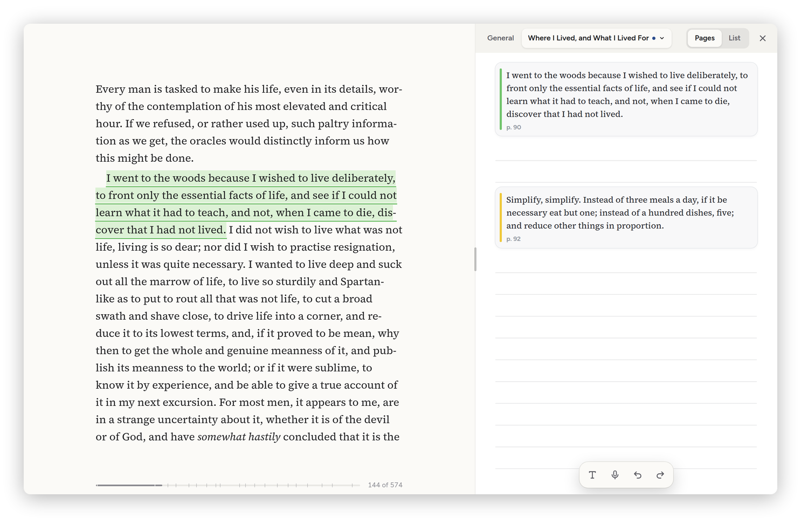

[Daf docs](README.md) › Using Daf

# The Notebook

The Notebook is one notebook beside whatever I'm reading or watching: a book, an article, a YouTube video, a podcast episode, a PDF or a manga volume. My highlights are in it, and so is everything I write and draw with the pen, type, or say into it. It's kept with the thing it's beside, in Daf, in my Obsidian vault and, for a book, on the Kindle.

There used to be two of these, the Sketchbook for the pen and the Notebook in the side panel for highlights, and I kept losing track of which one had what. Now there's one. The side panel only has **Info** and **Ask**.

*A chapter's highlights on its page in the Notebook, with room to write under each one.*

## Opening it

In a book, an article or a video the Notebook is the first tab of the side panel, beside **Info** and **Ask**, and one of the three is open at a time. The side panel's button in the bar (a box with a line down its right side) opens it at the tab I used last, and closes whatever is open, as the ] key does. **Notebook** in a book's **…** menu opens the Notebook itself. A PDF and the manga reader keep their own Notebook button (a page with a pen on it): before focus mode in a PDF, and in the manga reader's top bar. The ✕ in its corner closes it too. If I had it open the last time I read a book (or an article, a PDF, a manga), it's open again the next time.

- **Sideways** (the tablet on its side, or a computer) it's a panel on the right, and the book or the page gets the rest of the screen. I drag its left edge to make it wider, or back to the page's own width; pushed well past that, it closes.
- **Upright** (the tablet standing) it's a sheet from the bottom, a little over half the screen. I drag the handle on top to the height I want, and dragging it nearly all the way down closes it. The arrow button moves it to the top of the screen, and back.
- **On a phone** it's a big sheet from the bottom, with the book still showing above it.

It stays open in focus mode, and its pens stay with it.

## The top of it

Along the top are **General**, the chapter, **Pages** and **List**, and ✕.

A book has a page for each chapter and a **General** page for the book as a whole. The chapter button shows the chapter I'm in (the dot means that's where I am), and the Notebook follows me from chapter to chapter as I read. Tapping the chapter button opens the list of every chapter in the book, with how many highlights each has and a pen where there's writing, and I can go to any of them; it stays there until I go back to the chapter I'm in. A manga series has a page for each volume and General. An article, a video or a PDF has one page.

## Pages

A chapter's page has its highlights on it as cards, in the order they're in the book: the colour, the words, my typed note on it if it has one, and the page or how far in it is. Under each card there's ruled paper, and that's where I write about it. Anything I wrote on the page before there were any highlights stays at the top, above the cards.

When I highlight something while I'm reading, its card shows up on the page right where it belongs, between the ones before and after it, and the page scrolls to it. Tapping a card takes the book to that spot. On a phone the Notebook gets out of the way first, so I can see it.

The highlights are still highlights. They go to the review, the Highlights page and the book's vault note the way they always did, and changing one's colour or note shows on its card. The cards are made from the highlights; they aren't copied into the Notebook's own note in the vault.

## Writing, drawing and typing

The page is one size on each screen, like a sheet of paper. On the tablet it's as wide as the Notebook is when it first opens beside a book, upright or sideways, so my handwriting and the lines stay the same size whichever way I hold it. When I drag the Notebook wider, the page stays as it is and sits in the middle with room around it, and the edge won't go narrower than the page, so the lines never change size while I drag. On a phone the page is the phone's whole width.

The tools float at the bottom of the page: the pens, then **Type**, the microphone, and (in a manga or a PDF) the camera.

- **With the pen**, I write on the ruled paper under a card, and what I write stays with that card. Writing under everything goes with the last card; writing near the bottom of handwriting makes it longer. The pens are the same as on a book's pages: the seven kinds, the highlighter, the eraser and the lasso, with their sizes and colours, Undo and Redo, and the S Pen's button opens the round menu over the Notebook too. My fingers scroll. A tap with the pen is a dot.
- **Typing:** a tap with a finger (or a click) on the ruled paper under a card starts a piece of text there, and the **T** button starts one at the end of the page. A tap on typed text types into it. While I'm typing, a little bar above the text moves it up or down, or deletes it.
- **Blocks:** a tap with a finger on handwriting or a picture shows the same bar, with **Type below** to put text right under it. Moving something up past the top of a card's notes puts it with the card before; moving it down past the bottom puts it under the next card.
- **Handwriting into text:** the lasso's **To text** works here too. **Typed, in its place** swaps the handwriting for the typed text; **Note on the passage** puts the text under the handwriting and keeps both.

A moment after I stop writing, Daf reads my handwriting (in English with the reader it uses for the lasso; Hebrew in the Android app). That's what the List shows, what Obsidian shows as the handwriting's text, and what the Kindle gets.

If I delete a highlight, what I wrote under it stays where its card was, so nothing I wrote goes with it.

## List

**List** is everything in the Notebook at once: every highlight in the book, chapter by chapter, with what I wrote and typed under it (handwriting shown as the words Daf read in it), and what's on the pages by itself. The search box at the top looks through all of it, the highlights' words, their notes and my handwriting. **All**, **Highlights** and **With notes** narrow it down.

Each highlight in the list has its note, tags, favourite and **…** buttons, the same as on the Highlights page, so I can change its colour, make a flashcard or delete it from here. Tapping a highlight's words takes me to its card on its page; tapping a page's own writing opens that page.

**Note** on a highlight's bar while I'm reading opens the List at that highlight, with its note ready to type in.

## Saying it

The microphone button records. I tap it, talk, and tap it again, and the server writes down what I said and puts it where I was typing, or as new text at the bottom. It hears English and Hebrew. In the Android app it asks for the microphone the first time. The keyboard's own voice typing works too, inside any text.

## Videos and podcasts

In a video's or an episode's Notebook the clock button is on, and it stamps the time: what I type gets the time the video was at, and so does handwriting I start while it plays. Tapping a stamp takes the video there. In Obsidian the stamps link to that moment on YouTube.

## Taking the page

In the manga reader and a PDF, the camera button takes the page I'm looking at into the Notebook. I drag a box round the part I want, or press **Whole page** (both pages of a spread when they're side by side). The picture goes at the bottom of the page, with its page number, and I can write and draw on it.

## In Obsidian

Each thing I write in gets a note of its own beside its note in the vault, called "… — Sketchbook" (the name it had before), and the thing's note shows it under **Sketchbook**. A book's note is made for it if it has none yet, an article's or a video's is its clipping note, and a manga series' is the note I already have for it (or one Daf makes when there isn't one). The highlights themselves stay in the thing's own note, where they always were.

In the Sketchbook note every chapter or volume has its own heading, and under it what I wrote, in order:

- my typed text as plain paragraphs;
- my handwriting and drawings as **Ink** blocks, the same as the Ink plugin makes. They're pictures anywhere, even without the plugin, and with Ink I can open one and keep writing in it. What Daf read in the handwriting is the picture's text, so it's searchable;
- the pages I took, as ordinary pictures, with whatever I drew on them in an Ink drawing right under the picture.

It goes both ways. If I change a paragraph in Obsidian, add one, move things around or delete something, Daf takes that in. So does writing more in an Ink block, or adding a new Ink block to the note. Daf never writes over a change it hasn't taken in yet: anything changed in Obsidian since Daf last wrote it is merged first, block by block.

## On the Kindle

When I open a book on the Kindle, its Notebook pages come along as bookmarks at the start of each chapter (General at the start of the book), with my typed text and my handwriting's text as the bookmark's note, and "[Drawing in Daf]" when there's a drawing it can't show. If I change a page in Daf, the bookmark changes the next time the book opens there.

## Everywhere, and offline

The Notebook is kept on the server, so it's the same on the tablet, the phone and the Mac. Written with no signal, it waits on the device and goes when I'm back online, like highlights do. Dictation, Obsidian and the List's view of the other chapters need the server.
