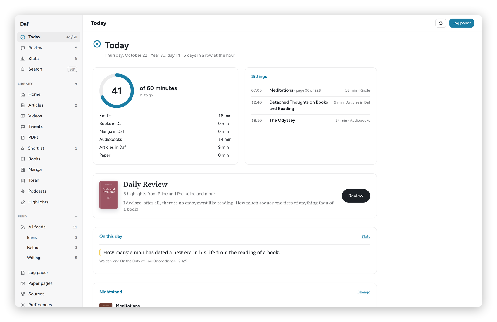
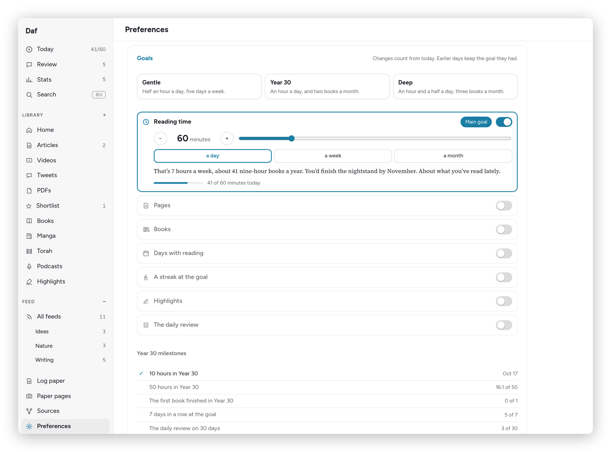

[Daf docs](README.md) › Using Daf

# Today and goals

**Today** is the page Daf opens on, and it answers one question: how much have I read today, and how far am I from the goal. This page goes through it card by card, and then through the goals in Preferences that decide what the ring is measuring.

*Today, with 41 of 60 minutes read.*

## The top of the page

Under the title is the date, then "Year 30, day N", then the streak: "5 days in a row reading", or "N days in a row at the hour" once the hour starts happening. The sidebar shows the same numbers next to **Today**, like "45/60", so you see them from every page.

## The sidebar

The sidebar has six places: **Today**, **Review**, **Library**, **Books**, **Feed** and **Highlights**. The little arrow next to Library opens its kinds (Articles, Videos, Tweets, PDFs and my saved views), and the one next to Feed opens its folders. Under them is **Pinned**, which I choose in **Preferences → Sidebar**: Podcasts, Manga, Torah, Recovery and Shortlist to start with, and Paper pages and Sources if I want them. At the bottom are **Search** (⌘K), **Stats** and **Preferences**. Anything that isn't pinned is still one ⌘K away.

It comes in three sizes, and each device remembers its own:

- **Full**, with the names. The button at its top makes it mini.
- **Mini**, a strip of icons. The buttons at its bottom make it full again or hide it.
- **Hidden.** The button at the top left of the page, or a swipe in from the left edge on a touch screen, brings the mini one over the page for a moment.

⌘\\ goes round the three. When something is open to read, the sidebar is always hidden, the way Readwise does it, and the same swipe or ⌘\\ brings it.

At the top right, the round arrow syncs every source now instead of waiting for the next five-minute pass, and **Log paper** opens the dialog for minutes read in a paper book (see [Paper books](paper-books.md)).

A few notices show up above the cards only when they matter:

- On Friday, "Shabbat is coming", with a reminder that the parasha is on the Torah shelf and that paper minutes can be logged after havdalah.
- When the Kindle reaches the end of a book: "You reached the end of … on the Kindle. Mark it read on Hardcover?", with **Mark it read** and **Not yet**.
- When you've been reading a book that isn't on your nightstand: **Swap it in** puts it there, and **Just browsing** tells Daf to leave it alone.

## The ring

The big card is the ring: today's minutes "of 60 minutes", with "15 to go" under it, or "That's the hour." once you're there. Under the ring is every source with its minutes today: Kindle, Books in Daf, Manga in Daf, Audiobooks, Articles in Daf and Paper, plus Videos and Podcasts on a day they have minutes. A source you've switched off in Preferences still shows, marked "not counted", so you can see the time without it going into the ring.

Beside it, **Sittings** lists each stretch of reading with its time, its book and page, how long it was and where it happened. Kindle reading shows up when the Kindle sleeps or closes a book, and audiobooks every five minutes.

## The rest of the page

- **Daily Review:** today's highlights, how many there are, and the first one. **Review** starts it, and once you're done it says so, with the review streak. More in [Highlights and review](highlights-and-review.md).
- **On this day:** highlights you made on this date in earlier years, when there are any, with a link to **Stats**.
- **Nightstand:** the three books you're reading now, with their progress on the Kindle, in Daf and in the audiobook. **Change** picks different ones.
- **This week:** a bar for each day, with the minutes over it.
- **Year 30:** the year as a grid of 365 squares, darker the more you read, from "none" to "an hour or more", with the hours so far, days read, days at the hour and days in.
- **Year 29:** the year before, the same way, so you can see what you're up against.

At the very bottom, a line says how fresh the sources are, for example "Kindle: newest page 12 h ago (Daf plugin) · Audiobookshelf checked 6 min ago". If a number looks wrong, that line usually explains why.

## Goals

The goals live in **Preferences**, at the top. There are three presets to start from:

- **Gentle:** half an hour a day, five days a week.
- **Year 30:** an hour a day, and two books a month.
- **Deep:** an hour and a half a day, three books a month.

*Preferences → Goals, with the Year 30 preset.*

Under them is one card per kind of goal, each with its own switch: **Reading time** (a day, a week or a month), **Pages** (a day or a week), **Books** (in Year 30, a year, or by 35), **Days with reading**, **A streak at the goal**, **Highlights** and **The daily review**. Use − and + or the slider to set the number. Each card says in a sentence what the goal means in practice, like "That's 7 hours a week, about 41 nine-hour books a year", and how you've been doing lately, so you can tell a stretch from a fantasy.

**Make main** picks the goal that drives the ring on Today, the widget and the Kindle. For most people that's reading time.

A few details worth knowing:

- **A change counts from today.** Earlier days keep the goal they had, so raising the goal never ruins last month's streak.
- **Pages** come from Kindle page turns of five seconds or more (each page once a day), pages shown in Daf's book reader, and the pages you type when you log paper.
- **Books** count when Hardcover has a read date or Daf's reader passes 97%. Manga volumes only count if you tick "Manga and comic volumes count as books".
- **Year 30 milestones** under the goals, like "10 hours in Year 30" and "The first book finished in Year 30", get a small celebration the first time you reach them, once on each device.

Days start and end in your **Home time zone** (Preferences → Days), which matters if you travel: switch it when you land, and the hour belongs to the right day.

If you only change one thing, choose a preset and leave the rest alone for a week.

Next: [Where the minutes come from](reading-time.md) →
