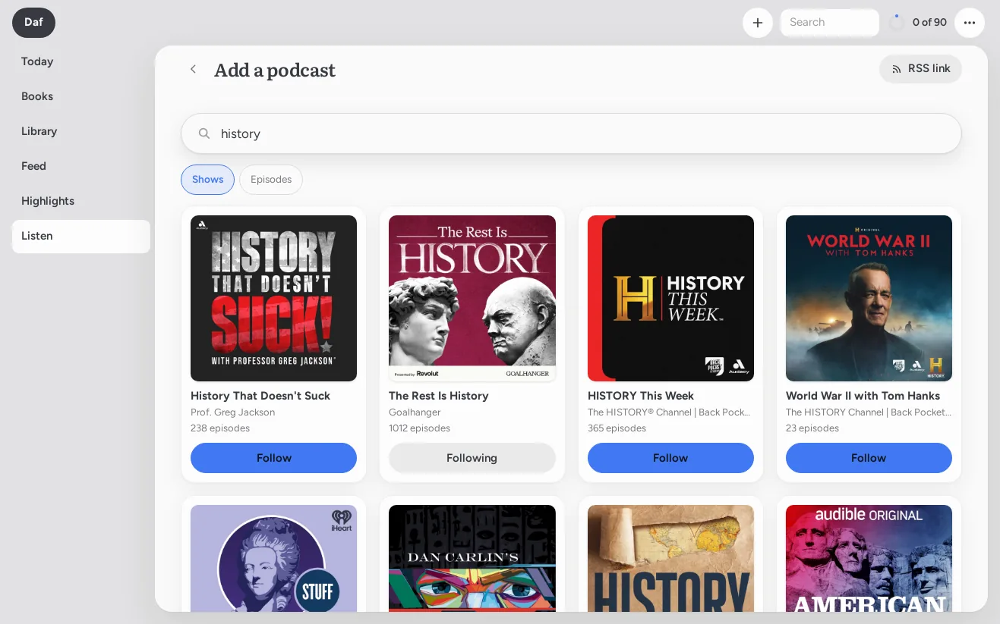
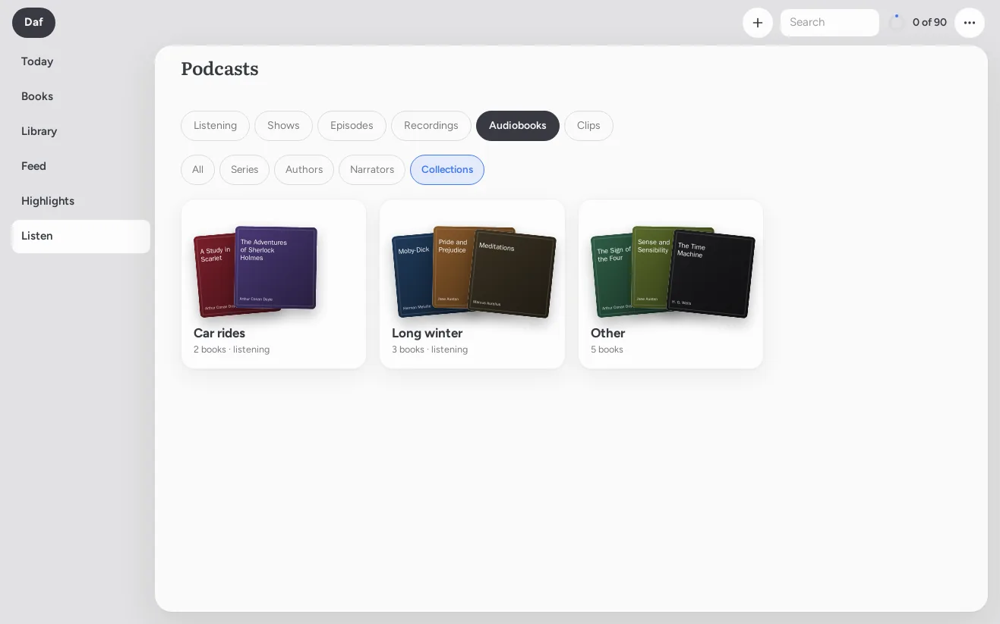
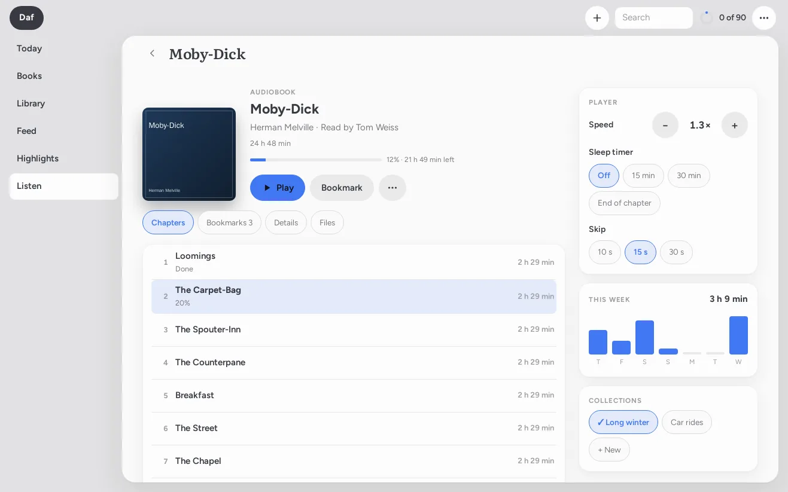

[Daf docs](README.md) › Using Daf

# Videos and podcasts

This page covers the things you watch and listen to: YouTube videos and Instagram reels saved to the Library, podcasts, the recordings and audiobooks in Audiobookshelf, and audiobook bookmarks. Daf doesn't try to be a video app. On the phone I still mostly listen in AntennaPod, but the Podcasts tab is where I find things, and anything plays in Daf too. What Daf adds is the text, so a good minute of a talk can become a highlight like any line in a book.

## Videos

Videos I save show up under **Videos** in the Library. Open one and the player sits above its transcript, a line per caption with the time beside it. Click a line and the video jumps there, and **Follow along** keeps the transcript scrolling with the video.

The transcript comes from YouTube's own captions when there are any, the ones a person made for the video if it has them, and YouTube's automatic ones if not. When there aren't, Daf transcribes the audio itself with faster-whisper on the server, which is slow, so it only happens when you ask: **Get YouTube's captions** or **Transcribe on the server (slow)**. Long videos get their chapters as headings.

YouTube's automatic captions scroll up a line at a time, and each new caption starts with the line before it, so Daf used to print every line two or three times. Since November 2026 it keeps each line once, and a phrase the speaker really did say twice stays twice. A transcript made before that is cleaned with `daf captions-rebuild` on the server, which fetches YouTube's captions again. It leaves alone any video I've highlighted, because the highlights would lose their place.

**Clip 30s** (or c) highlights the last thirty seconds of what you just heard, which is the BEST way I've found to keep something from a talk. The highlight keeps its time and the words that were said, and it goes into the review like any other.

Keys: Space plays and pauses, c clips, and ← → move ten seconds. The player is YouTube's privacy-mode embed, and **Watch in Materialious** opens it in my own Materialious instead.

Video time doesn't count toward the hour unless you switch on **Videos** in **Preferences → What counts toward the goal**. I keep it off, because watching isn't what Year 30 is about.

## Instagram reels

A reel I share to Daf (**Share → Daf** in the Instagram app, the browser's toolbar button, or its link pasted in) is kept as its link, under **Videos**, and opens on Instagram. Daf doesn't fetch anything from Instagram itself: Instagram takes a sign-in used from a server for a stolen one and locks the account, so Daf keeps no Instagram sign-in at all. A reel Daf kept whole before that still plays in Daf, with its transcript.

## Podcasts

Daf speaks the small part of the gpodder.net sync API that AntennaPod uses, so AntennaPod can sync to Daf as if Daf were gpodder.net, and nothing about how you listen changes.

To connect it, go to **Preferences → Podcasts (AntennaPod)**, press **Make a password** and copy it (Daf shows it only once), then follow **Set up AntennaPod**, which has the exact server address and username to type into AntennaPod's synchronization settings.

If AntennaPod used to sync to Nextcloud's GPodder Sync app, which is how I had it, `daf podcasts-import` on the server brings that history over first: the subscriptions, the ones you dropped, and where you stopped in each episode. It only reads from Nextcloud, never writes, and running it again adds only what's new. Then switch AntennaPod's sync from Nextcloud to Daf.

Listening shows up among the day's sittings, but it never counts toward the hour. That was a decision, not a missing feature: the hour is for reading.

## The Podcasts tab

Along the top are the tab's parts, and on Listening, Shows and Episodes there's an **Add a podcast** button in the corner (just a + on the phone):

- **Listening** is what I'm in the middle of, the last one I played first, whether it's an AntennaPod show, one of my recordings or an audiobook, and then **New**: the latest episodes from the shows I follow that I haven't played yet.
- **Shows** are the ones I follow, with how many episodes I haven't played. They sort by **Recent** (the newest episode first), **A–Z** or **Unplayed**.
- **Episodes** is every episode of every show I follow, and the chips narrow it to **Unplayed**, **In progress**, **Played**, **Transcribed** or **Clipped**. **Newest**, **Oldest** and **Longest** sort them.
- **Recordings** and **Audiobooks** come from Audiobookshelf, below.
- **Clips** are the highlights I've made in episodes.

Every episode row has its date and length, a bar for how far I got (or **Played**), and a tag when it has a transcript or clips. Tapping the row opens the episode's page, and the round button on the right plays it right there, without leaving the list.

## Adding a podcast

**Add a podcast** opens a page that's just for that: a big search box for Apple's podcast directory, and **Shows** or **Episodes** under it. With Shows, every show comes as a card with its picture, who makes it and how many episodes it has, and a **Follow** button right on the card, which turns into **Following** once I have it. With Episodes, each one plays from its round button like any other episode, so I can try one before I follow anything.

If a show isn't in the directory (a private feed, or something small), **RSS link** at the top takes the feed's address. It opens the show's page from the feed itself, and **Follow** there adds it the same way. Either way, AntennaPod gets it the next time it syncs.

## A show's page

A show's page has its picture, what it's about (**More** shows the rest), its website, how many episodes it has and when it last had a new one, and **Follow** or **Following**.

Next to that is **Download**: **Off**, **New episodes** or **All**. This is Daf keeping a copy of the episodes on my server, not on the phone. With **New episodes**, every episode that comes out from now on is downloaded the day it shows up in the feed, and with **All**, every episode the feed has comes down, one at a time (Daf asks first when that's more than forty). Off stops the ones still waiting but keeps what's already there. Each episode row also has its own download button, so I can keep just one: an arrow when it isn't kept, a little clock while it waits, a spinning circle while it comes down, and a check mark once it's there. Tapping the check mark removes it, after asking.

The reason I wanted this is that a kept episode plays from Daf's own copy, so it starts and skips around right away, it's still there when a show drops old episodes from its feed (a lot of them only keep the last hundred or so), and the transcript is made from that copy instead of downloading the whole thing again. Daf won't download anything when the server's disk has less than 20 GB free.

**Mark all played** marks every episode I haven't played as played, after asking. It goes to AntennaPod as a play to the end, so AntennaPod marks them too when it syncs, and none of it counts as listening time.

The episodes have chips along the top: **Unplayed** (where it starts), **All**, with the number, and **Downloaded**, and then **In progress**, **Played**, **Transcribed** and **Clipped** when the show has any of those. **Newest**, **Oldest** and **Longest** sort them, and the magnifying glass searches just that show.

## Finding things

The magnifying glass at the top of the tab searches everything at once. First what's mine: my shows, then my episodes, by their titles, their show notes and, when Daf has the transcript, what was actually said in them, the best matches first. Then my recordings and audiobooks in Audiobookshelf. And last, Apple's podcast directory, for shows I don't follow yet and their episodes.

Any episode in the results plays with its round button, and opens to its page like any other. A show from the directory opens to its page, and **Follow** there (or right under it in the results) adds it to my subscriptions. AntennaPod gets those from Daf, so the show turns up in AntennaPod the next time it syncs, and unfollowing one takes it out of AntennaPod the same way. If I don't want to wait, AntennaPod's synchronization settings can sync now.

## Recordings and audiobooks

The things I've put in Audiobookshelf myself are in the tab too, and they never mix with AntennaPod's shows. **Recordings** is Audiobookshelf's podcast library: each set of recordings is a tile, and it opens to its episodes, which sort and filter like a show's (when a recording has no date, **Oldest** goes by its number and then its title).

**Audiobooks** has chips along the top: **All**, **Series**, **Authors**, **Narrators** and **Collections**. All starts with **Continue**, the ones I'm in the middle of, and then every audiobook, by **Recent** or **A–Z**, each with how much is left and a play button under it. The other chips turn the books into cards, one for each series, author, narrator or collection, with three of the covers fanned out on it and how many books it holds. A card opens to just those books, and a series is in its order, Book 1 first. Collections also get an **Other** card for the books that aren't in any.

They play in Daf's player the same way an episode does, and an audiobook's files play as one, with its chapters in the player. Where I stop goes back to Audiobookshelf as I listen, the same way its own app does it, so Audiobookshelf and its apps carry on from there, and the time counts the way it always has: audiobooks toward the hour, the recordings not at all.

## An audiobook's page

Every audiobook opens to its own page now, which is where I wanted the things Audiobookshelf can do without having to go to Audiobookshelf. On top it has the cover, who wrote it and who reads it, the series and which book it is, and a bar for how far I am with how much is left. Under that are **Play**, **Read along** (when the audiobook is matched to a book in Daf, it starts playing and opens the book, which follows the narrator if it's prepared), **Bookmark**, and **⋯** for **Mark as finished** and the book's own page.

Under those are four tabs:

- **Chapters**, each with its length, the ones I've finished marked **Done** and the one I'm in highlighted with how far into it I am. Tapping a chapter plays from its start.
- **Bookmarks**. **Bookmark** marks where I am right now (the player's place if it's playing, otherwise where Audiobookshelf has me), named after the chapter, and the pencil renames it and the bin deletes it. These are Audiobookshelf's own bookmarks, so they're the same ones its app shows, and they still turn into highlights the way the next section says.
- **Details**: what Audiobookshelf knows about the book, and **Find details**, which asks one of Audiobookshelf's own match providers (Audible, Google Books, Open Library, iTunes and the rest) and lists what it finds. **Use** on one of them, after asking, writes its details and its cover into Audiobookshelf, the same as Match does there.
- **Files**: every file in the book's folder, with its size.

On the side (under everything on the phone) are three small cards. **Player** has the speed with − and +, a **Sleep timer** (Off, 15 min, 30 min or End of chapter, and if nothing's playing yet it starts with the next thing I play), and **Skip**, 10, 15 or 30 seconds, which sets both skip buttons in the player for everything. **This week** is a little bar chart of how long I listened to this book on each of the last seven days. **Collections** has my Audiobookshelf collections as chips, with a check on the ones the book is in; tapping one puts it in or takes it out, and **+ New** makes a new collection with this book in it.

Everything on this page that changes something (bookmarks, collections, finished, details) is saved in Audiobookshelf itself, through the same API its apps use, so nothing lives only in Daf.

## An episode's page

Any episode opens as a page in Daf, whether it's from the Podcasts tab, a search, a show, or a podcast episode in the Feed. Its play button and the time sit on top, with the show's picture, and the transcript is under it, a line per stretch with the time and who's talking when the transcript knows. It works the way a YouTube video does here:

- Once it's playing, it plays in Daf's player along the bottom of the screen, so I can go anywhere else in Daf, or leave the app, and it keeps going. The bar has the picture, the title, back 15, play and pause, ahead 30 and ✕. Tapping it (or pulling it up) opens the whole player: the time to drag, the speed, a sleep timer (to the end of the chapter too), the chapters, and **Go to it**, which brings me back to the episode's page. Pulling it down puts it back.
- Click a line's time and it plays from there. **Follow along** keeps the transcript scrolling with the audio.
- **−15** and **+30** skip the way AntennaPod does, and so do ← and →. The **1×** button steps through the speeds, and Daf remembers the last one.
- **Chapters**, when the episode has them, are headings in the transcript and a menu in the player.
- **Clip 30s** (or c) highlights the last thirty seconds. It works even before the transcript is there: the server transcribes just those thirty seconds and the highlight shows up in the Notebook a minute later.
- Space plays and pauses, and the Mac's media keys work too.

Where I stop goes back to AntennaPod as if I'd played it there, so the phone picks it up the next time AntennaPod syncs. And it works the other way round as well: an episode opens where I last stopped, in Daf or in AntennaPod, and says which.

The show notes come after the transcript, and **Show notes** goes straight to them. An episode that only lives in AntennaPod gets **Save to Library**, the same as a Feed item, and anything I highlight or clip in a Feed episode saves it to the Library anyway.

Daf for the Mac has the same page and the same **Podcasts** page. There, P plays and pauses, and the episode shows in Now Playing, so the keyboard's media keys and Control Center work too.

## Transcripts

A few shows put their own transcript in the feed (the Podcasting 2.0 tags). When they do, Daf uses theirs, and it's there in seconds, speakers and all. Only a few of mine do.

For everything else, Daf transcribes the episode on the server with faster-whisper. It's automatic for any episode I play, in AntennaPod or in Daf, and for any episode I open from a show I follow. One I've only opened from the directory waits until I play it or press **Transcribe**. It takes about a quarter of the episode's length, so an hour comes back in about fifteen minutes, and Hebrew works too. If I'd rather it only happened when I ask, I switch off **Transcribe episodes I play or open** in **Preferences → Podcasts**, and then each episode has a **Transcribe** button.

Search (⌘K) finds what was said, not just the titles.

When I highlight anything in an episode, its note goes to `Reference/podcasts` in the vault with the whole transcript, and every time in it is a link back into Daf at that moment.

## Clips from AntennaPod

When I'm out with the phone and something is worth keeping, I share it from AntennaPod "with position", or send a link with a time in it. Daf highlights the minute before that point on the episode's page, from the transcript if it has one and by transcribing that minute if not, in about thirty seconds. It goes into the review like any other highlight and into the episode's note in the vault.

I send these to my Signal bot, which recognizes a link with `#t=750`, AntennaPod's "Starting position: 00:12:30", or "clip" plus a link and a time. On the server, the same thing is `daf clip "the link and the time"`, and `daf jobs` lists the transcripts and clips that are waiting or done.

## Audiobook bookmarks

Bookmarks in Audiobookshelf work the same way. For each one, Daf transcribes the minute of the audiobook before the bookmark and keeps it as a highlight, shown as "Audiobook" with the time. If you title a bookmark with a sentence instead, that sentence becomes the highlight. Either way, it lands in the book's Notebook in reading order, next to the Kindle's highlights from the same book, and in the daily review.

Basically, if you hear something worth keeping, mark the spot and keep listening, and the words are waiting for you in Daf afterwards.

Next: [Highlights and review](highlights-and-review.md) →
